# One table. Four machines.

**HackLab #2 Berlin · Prior Labs track "TabPFN for spatial awareness" · 21–22 Nov 2026**

Four robots, one pretrained model, no training. We write each machine's own log as a table, and **TabPFN** reads its past rows as examples to predict where things are, where they are going and what happens next. To adapt to something new, it gets more rows, not retraining.

### 🌐 Demo website: **[priorlabberlinhack.vercel.app](https://priorlabberlinhack.vercel.app)**

**Pitch deck:** [priorlabberlinhack.vercel.app/pitch](https://priorlabberlinhack.vercel.app/pitch) (← → to move, F for full screen) · **Full reports:** one page per project on the website · **Code:** this repo

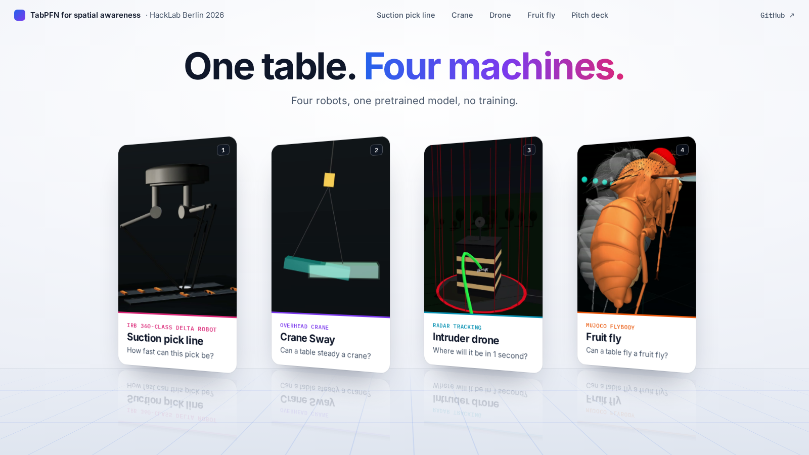

## The idea

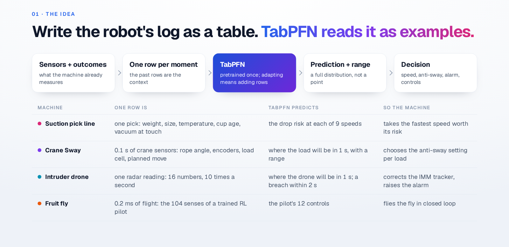

Every machine already measures what a prediction needs. We turn that log into one row per moment (a pick, 0.1 s of crane, one radar reading, 0.2 ms of flight), give the past rows to TabPFN as context, and let it predict the next outcome **with a range**. The machine then makes its decision from that prediction: a speed, an anti-sway setting, an alarm, or the fly's 12 controls.

## The four projects

Each project has its own folder, README, setup and full report. The suction pick line is the exception: its code lives at the repo root (see [Repository map](#repository-map)).

| | Project | Question | Headline result | Still fails | Docs |
|---|---|---|---|---|---|
| 1 | **Suction pick line** (delta robot, ABB IRB 360 class) | How fast can this pick be? | TabPFN sets the speed of every pick: **1 vs 31 drops** on a 120-pick shift against the fast fixed recipe; **+13 %** picks/min on a product it has never seen, 0 drops | drops the first unseen heavy bar before it slows down | [below](#project-1-in-depth-suction-pick-line) · [`docs/report.html`](docs/report.html) |
| 2 | **Crane Sway** (overhead crane) | Can a table steady a crane? | **5×** closer than physics 1 s ahead (real lab crane); **−35 %** time on 12 new loads | timing the set-down alone | [`crane/`](crane/README.md) · [`crane/docs/report.html`](crane/docs/report.html) |
| 3 | **Intruder drone** (radar tracking) | Where will the drone be in 1 second? | IMM + TabPFN: **−10 %** error on a pilot it never saw (1.80 → 1.62 m) | too slow for the 100 ms radar cycle | [`drone/`](drone/README.md) · [`drone/EXPLAINED.md`](drone/EXPLAINED.md) |
| 4 | **Fruit fly** (MuJoCo flybody) | Can a table fly a fruit fly? | flies an S-curve **0.10 mm** off the path, as precise as the trained RL pilot (0.09 mm) | sudden 80° turns | [`fly/`](fly/README.md) · [`fly/docs/report.html`](fly/docs/report.html) |

| Suction pick line | Crane | Drone | Fruit fly |
|---|---|---|---|
| 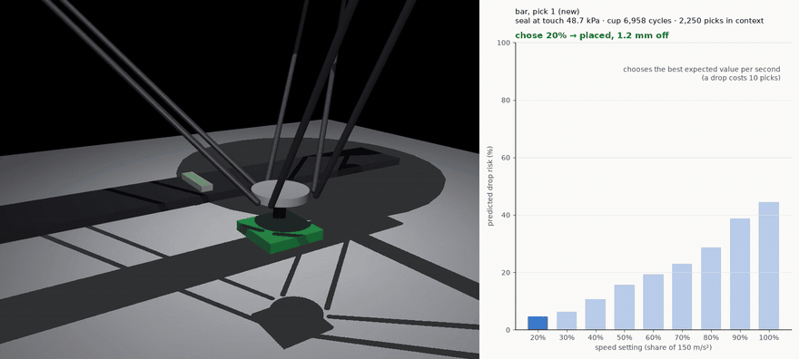 |  |  |  |
| A product the line never logged: TabPFN starts at 20 % speed and climbs to 50–60 %, no drops | Ghost = TabPFN's predicted load position 1 s ahead | Green: real path. Blue: IMM. Orange: TabPFN. Purple: IMM + TabPFN | All 12 controls from a table, 360°/s turn for 1 s |

### Videos

Click a frame to play the video (GitHub opens its player).

| Suction pick line | Shift: TabPFN vs fixed recipe | Crane | Drone | Fruit fly |
|---|---|---|---|---|
| [](docs/media/hero.mp4) | [](docs/media/shift_split.mp4) | [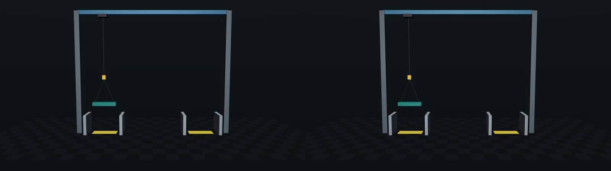](docs/media/crane_split.mp4) | [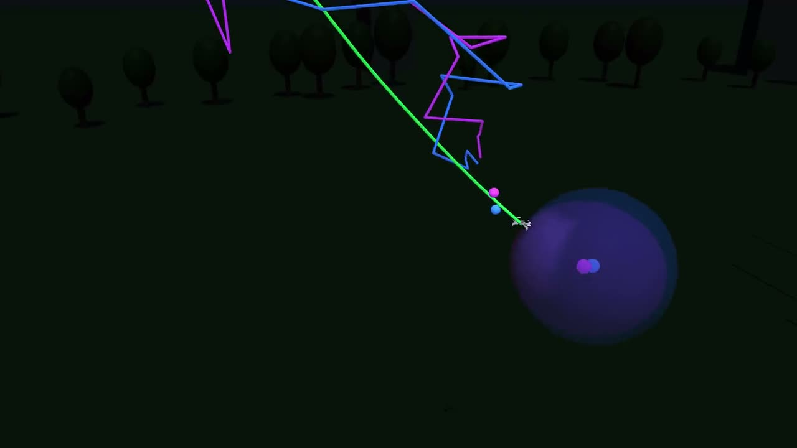](docs/media/drone.mp4) | [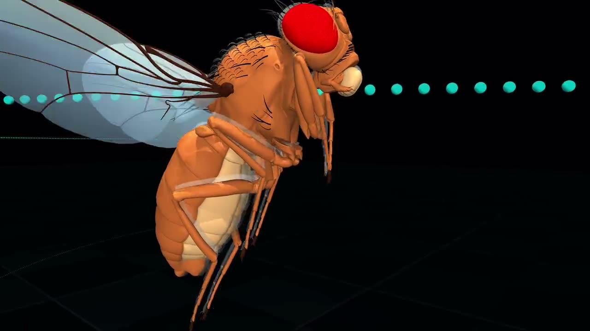](docs/media/fly.mp4) |

## Results

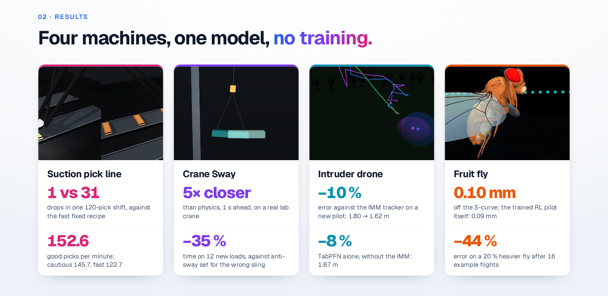

## Findings

1. **It adapts by adding rows, not by training.** The crane's error drops 3× after 5 s of an unseen load. A 20 % heavier fly: −44 % error after 16 example flights. On a product the pick line never logged, TabPFN climbs from 20 % to 50–60 % speed without a drop.
2. **It knows when it is unsure.** Calibration error 1.1 % over 2,700 picks, against 4.0 % for boosted trees. Every forecast comes with a range, so the machine can price the risk of each decision.
3. **It beats the domain's own baselines at prediction.** 5–7× closer than the crane physics model when the sling is unknown; 2.2× lower error than gradient-boosted trees one wingbeat ahead on the fly; it improves the IMM, the radar standard.
4. **Speed is the frontier.** Our JAX port of TabPFN's query path decides a pick in 3.7 ms instead of 30.9 ms (PyTorch, laptop GPU), and 2.35 ms median on an H100, with the same answers (0 of 3,825 decisions differ). That fits the pick line's 35 ms seal window. The drone and the fly need the same speed-up next.

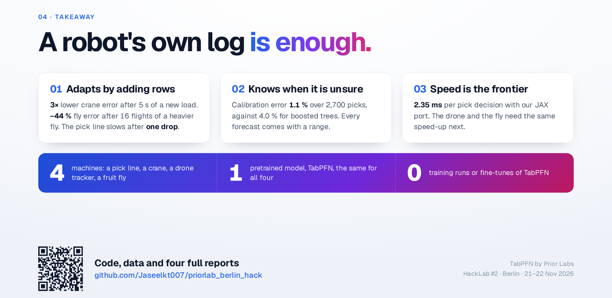

## Limitations

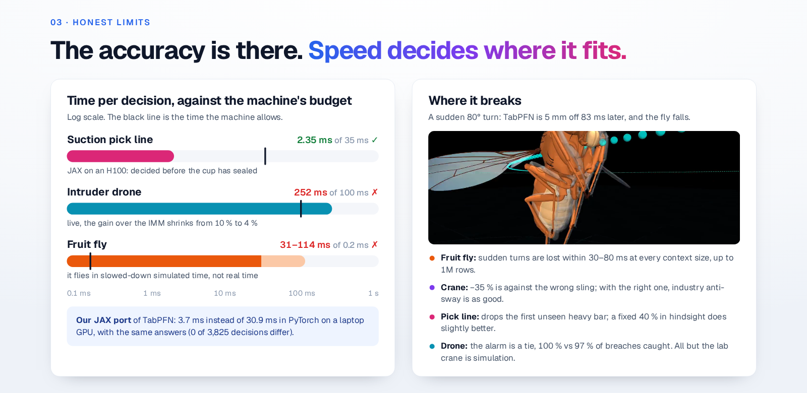

- **Everything except the lab crane is simulation** (MuJoCo). The pick line is checked part by part against vendor data (below), but it is not a real line.
- **Drone:** one TabPFN query takes 252 ms against a 100 ms radar cycle. Live, it corrects the IMM every 0.3 s and the gain shrinks from 10 % to 4 %. The breach alarm is a tie: the IMM alone catches 100 % of breaches, IMM + TabPFN 97 %.
- **Fruit fly:** 31–114 ms per decision against a 0.2 ms control step, so it flies in slowed-down simulated time, not real time. A sudden 80° turn is lost within 30–80 ms at every context size, up to 1M rows.
- **Crane:** the −35 % is against anti-sway set for the wrong sling. With the right sling typed in, industry anti-sway is as good. Timing the set-down alone does not work: the position is right, but the load still moves at 15 cm/s.
- **Pick line:** it drops the first unseen heavy bar, then slows down for every one after. A fixed 40 % speed chosen in hindsight does slightly better on that shift (155.6/min). With an abundant test campaign, a tuned recipe is as good as per-pick choice.
- **Licence:** the TabPFN weights are non-commercial; every project needs a `TABPFN_TOKEN`.

Every estimate and shortcut, with its real fix, is listed in [`DEBT.md`](DEBT.md).

## Run it in MuJoCo

One `TABPFN_TOKEN` for the whole repo, from [platform.priorlabs.ai](https://platform.priorlabs.ai):

```sh
git clone https://github.com/Jaseelkt007/priorlab_berlin_hack.git && cd priorlab_berlin_hack
echo "TABPFN_TOKEN=<your key>" > .env        # git ignores .env
```

Each project has its own environment. One command per project to watch it:

| Project | Setup (once) | Watch it |
|---|---|---|
| Suction pick line | `uv venv --python 3.12 && uv pip install -r pyproject.toml` | `.venv/bin/python scripts/view_pick.py --product bar --alphas 0.4,1.0` |
| Crane | `uv venv --python 3.12 crane/.venv && uv pip install --python crane/.venv/bin/python -r crane/requirements.txt` | `MUJOCO_GL=glfw crane/.venv/bin/python crane/live_pick_place.py --auto-tune` (TabPFN chooses the anti-sway), or `crane/run_live.sh` |
| Drone | Python 3.12, `pip install -r drone/requirements.txt`, drone models per [`drone/models/README.md`](drone/models/README.md) | `python drone/demo_imm.py --view radar --tabpfn` (a test flight live: real vs IMM vs TabPFN) |
| Fruit fly | conda env `flybody` + trained policies, see [`fly/README.md`](fly/README.md#1--setup) | `cd fly && conda run -n flybody python collect/view_flight.py --path tour` |

Videos render offscreen on a GPU server with `MUJOCO_GL=egl`. Every command that reproduces each project's numbers is in its own README; the pick line's are [below](#reproduce).

## Repository map

```
priorlab_berlin_hack/
├── README.md            this page
├── DEBT.md              every quick fix and estimate across all four projects, with the real fix
├── CLAUDE.md            how we build here (hackathon mode)
├── pyproject.toml       environment for the suction pick line (root)
├── .env                 TABPFN_TOKEN, one for the whole repo (not in git)
│
├── crane/               PROJECT 2: Crane Sway (own README, requirements, results, report)
├── drone/               PROJECT 3: intruder drone (own README, requirements, results)
├── fly/                 PROJECT 4: fruit fly (own README, pyproject, results, report)
│
│                        PROJECT 1: suction pick line, at the root
├── sim/                 pneumatics, cup, delta robot, motion planner, line, products and drift, pick logs
├── policy/              speed policies (TabPFN, fixed recipe, logistic, boosted trees, oracle) and replay
├── jax_tabpfn/          JAX port of TabPFN-3.5-Fast's cached query path
├── scripts/             sweeps, evaluation bank, evaluation, learning curve, figures, viewers, benchmarks
├── tests/               validation gates 1–5 (pytest)
├── results/             logs and evaluation runs behind every number (tables rebuild without simulating)
├── media/               pick-line renders
├── data/                generated logs (not in git)
│
├── showcase/            4K60 launch-film footage for all four projects
├── site/                project website and the 5-slide pitch deck (plain HTML, no build step)
└── docs/
    ├── report.html      pick-line technical report (videos, results, JAX speed-up)
    ├── research/        sourced research, model specs, every validation and evaluation write-up
    ├── figures/         pick-line charts and GIFs
    ├── media/           project videos and posters (used by the reports and this page)
    ├── readme/          the images on this page (screenshots of the deck and site)
    ├── HACKATHON.md     the brief, schedule and setup
    └── pitch.md         pitch script
```

---

## Project 1 in depth: suction pick line

**How fast can this pick be? TabPFN sets the speed of every suction pick.** Full technical report with videos, results and the JAX speed-up: [`docs/report.html`](docs/report.html) (open the file in a browser).

### The problem

On food and pharma packaging lines, a delta robot (ABB IRB 360 FlexPicker class) picks every product with a suction cup and flies it 0.3 m in about 0.15 s, at up to 150 m/s². If the robot accelerates too hard, the product drops: scrap, a stop, or contamination.

Today every product runs at **one fixed, cautious speed recipe**, set by an engineer at commissioning. The recipe can't know that this item has a poor seal, this cup is worn, or this cheese is wet with condensation. So the line wastes speed on easy picks and still drops the hard ones.

### The idea

The line already logs everything a speed decision needs:
- the checkweigher mass and the vision size;
- product and room temperature and humidity;
- the cup's cycle counter;
- the vacuum sensor's reading at touch.

**TabPFN reads that log as in-context data** and, for every pick, predicts the drop risk at each of the 9 speed settings. The robot then takes the setting with the best expected value. There is no training: each new pick's outcome is appended to the log and changes the next prediction. That is how it adapts to a worn cup, a humid afternoon or a product it has never seen.

```
touch ─► 35 ms vacuum dwell ─► sensor: seal_kpa, evac_ms ─► TabPFN: P(drop) at 20 %…100 % speed
      ─► fastest setting worth its risk ─► loaded move ─► outcome appended to the log
```

### Results (simulated line, every number from a run: `docs/research/evaluation.md`)


*A bar the line has never logged: TabPFN starts at 20 % speed and climbs to 50–60 % as its own picks enter the context, without a single drop. Right: its predicted drop risk at each speed for that pick.*

**1. TabPFN learns the drop risk from a few hundred logged picks, and its probabilities are calibrated.** Test set: 940 unseen picks × 9 speeds.

| | log-loss | calibration error | AUC |
|---|---|---|---|
| **TabPFN, 250 logged picks** | **0.159** | **2.5 %** | **0.985** |
| logistic regression, 2,700 picks | 0.157 | 1.8 % | 0.985 |
| **TabPFN, 2,700 picks** | **0.124** | **1.1 %** | **0.990** |
| boosted trees, 2,700 picks | 0.176 | 4.0 % | 0.987 |

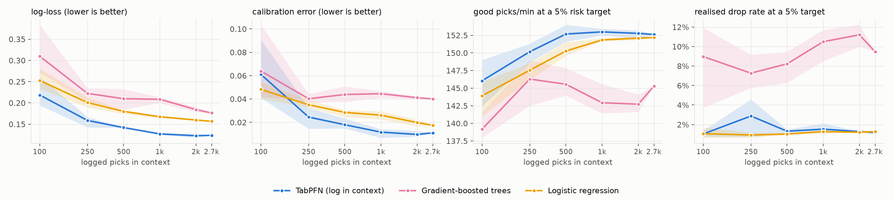

**2. It also predicts where the product will land.** The median placement error is 1.18 mm. Its 90 % intervals cover 85 % of outcomes, against 77 % for boosted trees at the same width; a linear model needs 44 % wider intervals to cover 89 %.

**3. In closed loop, with the commissioning data a line actually has, it matches or beats hand tuning, without any tuning.** Each policy maximizes the same thing: good picks minus c × drops per minute, where a drop costs c picks' worth. The figure plots that net value; uplifts are quoted with paired 95 % bootstrap intervals over the same picks.


- **Small commissioning log (10 test picks per speed and product), the same for every policy.**
  - The recipe tuned on it drops **10 %** of picks: 10 lucky tests made 60 % look safe for the bar.
  - An engineer's safety margin fixes that, but the right margin flips with the drop cost.
  - **TabPFN matches or beats the best margin at every cost, with no margin to choose.** At c = 1: +3.8 net picks/min (95 % CI +1.6 to +5.7) over the best margin.
- **New product, never logged.** On the bar, TabPFN reaches 146.6 good picks/min with 0 drops, against 129.5 for the slow default (+13 %). Logistic regression and boosted trees reach the same speed but drop 5–6 %. Not every new product gains: the cheese is at its limit at the slowest setting.
- **Honest limit.** With an abundant, dedicated test campaign (50 picks per speed and product), a recipe tuned on the true drop rates is as good as per-pick choice; no difference is significant. On this line most per-pick risk comes from what no sensor sees (cup–product friction, vision error, a pouch's slosh frequency). TabPFN still ranks items well inside a product's limit (AUC 0.81–0.84), but few items are safe enough to go one step faster.

**4. Fast enough for the loop.** One query covers all 9 speeds: 23 ms with TabPFN-3.5-Fast on a laptop RTX 4050, inside the 35 ms vacuum dwell before the move. In closed loop it performs like 3.5. Our JAX port of the query path takes 3.7 ms, measured on an earlier log with the same number of columns.

**Physics we did not script.** Pouches whose contents slosh at 4–5 Hz drop more often at 60 % speed than at 70–80 %, because the move timing pumps the slosh mode. A "slower is always safer" rule is wrong for them.

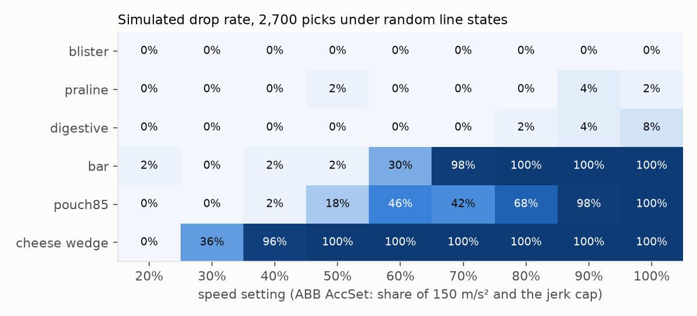

### How it is built, and how we know the simulation is right

No real line was available, so we built one in MuJoCo from vendor data and checked every part against an external reference before using it (`docs/research/*-validation.md`):

| Gate | What | Checked against |
|---|---|---|
| 1 Pneumatics | vacuum generator, cup volume, lip leaks (ISO 6358 + slit flow), sensor | Piab evacuation tables (±3 %), SMC adsorption test, Schmalz forces |
| 2 Cup | compliant lip ring (Dex-Net 3.0 spring model), vacuum force, bellows | lift and shear limits within 4 % of theory, peel onset |
| 3 Seal and warning | seal vs surface roughness; what a near-miss looks like | Schmalz/SMC data; peel is abrupt, shear gives graded slip |
| 4 Delta robot | closed-chain IRB 360-class robot, exact feedforward, TOPP-RA time-optimal planner with ABB's foundation-load limits | ABB workspace, path accuracy, cycle times (held-out cycle −2.5 %) |
| 5 Line | belt, PickMaster-style tracking, vision error, 6-product catalogue with drift (cup wear, condensation, batches) | belt and tracking tests; placement error vs ABB's table; drop onset vs Schmalz's sizing rule (S* = 1.94) |

Every estimated value is tagged and listed in `DEBT.md`.

### Reproduce

```sh
uv venv --python 3.12 && uv pip install -r pyproject.toml
echo "TABPFN_TOKEN=<key from platform.priorlabs.ai>" > .env       # TabPFN weights licence (non-commercial)
.venv/bin/python -m pytest tests/ -q                                  # gates 1-5
.venv/bin/python scripts/sweep_picks.py 25 data/commission_lap.csv --s0 0     # commissioning log, half 1
.venv/bin/python scripts/sweep_picks.py 25 data/commission_srv.csv --s0 25    # half 2
.venv/bin/python scripts/make_bank.py data/bank.csv                   # evaluation bank: 940 picks x 9 speeds
.venv/bin/python scripts/learning_curve.py data/commission_lap.csv,data/commission_srv.csv data/bank.csv data/eval/learning_curve.csv
.venv/bin/python scripts/run_eval.py data/bank.csv data/commission_lap.csv,data/commission_srv.csv data/eval --suite cost --safe-step
.venv/bin/python scripts/run_eval.py data/bank.csv data/commission_small.csv data/eval_small --suite cost --safe-step   # small log
.venv/bin/python scripts/run_eval.py data/bank.csv data/commission_small.csv data/eval_small --suite margin
.venv/bin/python scripts/placement.py data/commission_lap.csv,data/commission_srv.csv data/bank.csv data/eval/placement.csv
.venv/bin/python scripts/report.py data/eval && .venv/bin/python scripts/figures.py
.venv/bin/python scripts/view_pick.py --product bar --alphas 0.4,1.0  # watch picks in MuJoCo
```

Simulation is deterministic per seed. `DELTA_WORKERS` sets the number of worker processes. All logs and evaluation runs behind the numbers above are in [`results/`](results/README.md), so the tables can be rebuilt without simulating. `data/commission_small.csv` is the s < 10 subset of the laptop half.

---

## Team setup (hackathon)

Shared Claude Code skills, once per machine: `git clone https://github.com/Jaseelkt007/potato-skills ~/potato-skills && sh ~/potato-skills/install.sh` (optional: `npx skills add backnotprop/pstack -g`). The coding rules are in `CLAUDE.md` (hackathon mode). The full brief is in [`docs/HACKATHON.md`](docs/HACKATHON.md).
