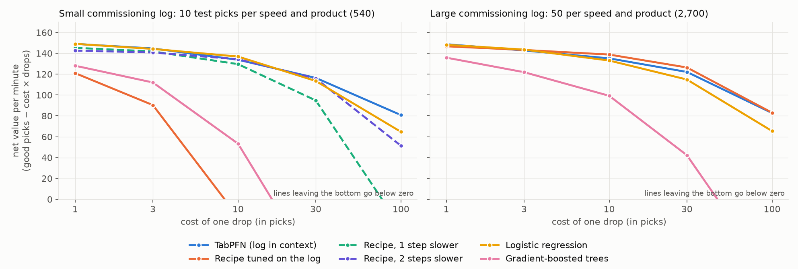

# How fast can this pick be? TabPFN sets the speed of every suction pick

HackLab #2 Berlin, Prior Labs track **"TabPFN for spatial awareness"**: predicting what happens next to an object a robot is holding, from a table of the robot's own past picks.

## The problem

On food and pharma packaging lines, a delta robot (ABB IRB 360 FlexPicker class) picks every product with a suction cup and flies it 0.3 m in about 0.15 s, at up to 150 m/s². If the robot accelerates too hard, the product drops: scrap, a stop, or contamination.

Today every product runs at **one fixed, cautious speed recipe**, set by an engineer at commissioning. The recipe can't know that this item has a poor seal, this cup is worn, or this cheese is wet with condensation. So the line wastes speed on easy picks and still drops the hard ones.

## The idea

The line already logs everything a speed decision needs:
- the checkweigher mass and the vision size;
- product and room temperature and humidity;
- the cup's cycle counter;
- the vacuum sensor's reading at touch.

**TabPFN reads that log as in-context data** and, for every pick, predicts the drop risk at each of the 9 speed settings. The robot then takes the setting with the best expected value. There is no training: each new pick's outcome is appended to the log and changes the next prediction. That is how it adapts to a worn cup, a humid afternoon or a product it has never seen.

```
touch ─► 35 ms vacuum dwell ─► sensor: seal_kpa, evac_ms ─► TabPFN: P(drop) at 20 %…100 % speed
      ─► fastest setting worth its risk ─► loaded move ─► outcome appended to the log
```

## Results (simulated line, every number from a run: `docs/research/evaluation.md`)


*A bar the line has never logged: TabPFN starts at 20 % speed and climbs to 50–60 % as its own picks enter the context, without a single drop. Right: its predicted drop risk at each speed for that pick.*

**1. TabPFN learns the drop risk from a few hundred logged picks, and its probabilities are calibrated.** Test set: 940 unseen picks × 9 speeds.

| | log-loss | calibration error | AUC |
|---|---|---|---|
| **TabPFN, 250 logged picks** | **0.159** | **2.5 %** | **0.985** |
| logistic regression, 2,700 picks | 0.157 | 1.8 % | 0.985 |
| **TabPFN, 2,700 picks** | **0.124** | **1.1 %** | **0.990** |
| boosted trees, 2,700 picks | 0.176 | 4.0 % | 0.987 |


**2. It also predicts where the product will land.** The median placement error is 1.18 mm. Its 90 % intervals cover 85 % of outcomes, against 77 % for boosted trees at the same width; a linear model needs 44 % wider intervals to cover 89 %.

**3. In closed loop, with the commissioning data a line actually has, it matches or beats hand tuning, without any tuning.** Each policy maximizes the same thing: good picks minus c × drops per minute, where a drop costs c picks' worth. The figure plots that net value; uplifts are quoted with paired 95 % bootstrap intervals over the same picks.



- **Small commissioning log (10 test picks per speed and product), the same for every policy.**
  - The recipe tuned on it drops **10 %** of picks: 10 lucky tests made 60 % look safe for the bar.
  - An engineer's safety margin fixes that, but the right margin flips with the drop cost.
  - **TabPFN matches or beats the best margin at every cost, with no margin to choose.** At c = 1: +3.8 net picks/min (95 % CI +1.6 to +5.7) over the best margin.
- **New product, never logged.** On the bar, TabPFN reaches 146.6 good picks/min with 0 drops, against 129.5 for the slow default (+13 %). Logistic regression and boosted trees reach the same speed but drop 5–6 %. Not every new product gains: the cheese is at its limit at the slowest setting.
- **Honest limit.** With an abundant, dedicated test campaign (50 picks per speed and product), a recipe tuned on the true drop rates is as good as per-pick choice; no difference is significant. On this line most per-pick risk comes from what no sensor sees (cup–product friction, vision error, a pouch's slosh frequency). TabPFN still ranks items well inside a product's limit (AUC 0.81–0.84), but few items are safe enough to go one step faster.

**4. Fast enough for the loop.** One query covers all 9 speeds: 23 ms with TabPFN-3.5-Fast on a laptop RTX 4050, inside the 35 ms vacuum dwell before the move. In closed loop it performs like 3.5. Our JAX port of the query path takes 3.7 ms, measured on an earlier log with the same number of columns.

**Physics we did not script.** Pouches whose contents slosh at 4–5 Hz drop more often at 60 % speed than at 70–80 %, because the move timing pumps the slosh mode. A "slower is always safer" rule is wrong for them.


## How it is built, and how we know the simulation is right

No real line was available, so we built one in MuJoCo from vendor data and checked every part against an external reference before using it (`docs/research/*-validation.md`):

| Gate | What | Checked against |
|---|---|---|
| 1 Pneumatics | vacuum generator, cup volume, lip leaks (ISO 6358 + slit flow), sensor | Piab evacuation tables (±3 %), SMC adsorption test, Schmalz forces |
| 2 Cup | compliant lip ring (Dex-Net 3.0 spring model), vacuum force, bellows | lift and shear limits within 4 % of theory, peel onset |
| 3 Seal and warning | seal vs surface roughness; what a near-miss looks like | Schmalz/SMC data; peel is abrupt, shear gives graded slip |
| 4 Delta robot | closed-chain IRB 360-class robot, exact feedforward, TOPP-RA time-optimal planner with ABB's foundation-load limits | ABB workspace, path accuracy, cycle times (held-out cycle −2.5 %) |
| 5 Line | belt, PickMaster-style tracking, vision error, 6-product catalogue with drift (cup wear, condensation, batches) | belt and tracking tests; placement error vs ABB's table; drop onset vs Schmalz's sizing rule (S* = 1.94) |

Every estimated value is tagged and listed in `DEBT.md`.

## Reproduce

```sh
uv venv --python 3.12 && uv pip install -r pyproject.toml
echo "TABPFN_TOKEN=<key from platform.priorlabs.ai>" > .env       # TabPFN weights licence (non-commercial)
.venv/bin/python -m pytest tests/ -q                                  # gates 1-5
.venv/bin/python scripts/sweep_picks.py 25 data/commission_lap.csv --s0 0     # commissioning log, half 1
.venv/bin/python scripts/sweep_picks.py 25 data/commission_srv.csv --s0 25    # half 2
.venv/bin/python scripts/make_bank.py data/bank.csv                   # evaluation bank: 940 picks x 9 speeds
.venv/bin/python scripts/learning_curve.py data/commission_lap.csv,data/commission_srv.csv data/bank.csv data/eval/learning_curve.csv
.venv/bin/python scripts/run_eval.py data/bank.csv data/commission_lap.csv,data/commission_srv.csv data/eval --suite cost --safe-step
.venv/bin/python scripts/run_eval.py data/bank.csv data/commission_small.csv data/eval_small --suite cost --safe-step   # small log
.venv/bin/python scripts/run_eval.py data/bank.csv data/commission_small.csv data/eval_small --suite margin
.venv/bin/python scripts/placement.py data/commission_lap.csv,data/commission_srv.csv data/bank.csv data/eval/placement.csv
.venv/bin/python scripts/report.py data/eval && .venv/bin/python scripts/figures.py
.venv/bin/python scripts/view_pick.py --product bar --alphas 0.4,1.0  # watch picks in MuJoCo
```

Simulation is deterministic per seed. `DELTA_WORKERS` sets the number of worker processes. All logs and evaluation runs behind the numbers above are in [`results/`](results/README.md), so the tables can be rebuilt without simulating. `data/commission_small.csv` is the s < 10 subset of the laptop half.

## Repository map

| Path | What |
|---|---|
| `sim/` | pneumatics, cup, delta robot, motion planner, line, products and drift, pick logs, scenarios |
| `policy/policies.py` | speed policies (TabPFN, fixed recipe, logistic, boosted trees, oracle) and the replay |
| `scripts/` | sweeps, bank, evaluation, learning curve, figures, viewers, demo clip, latency benchmark |
| `tests/` | validation gates 1–5 |
| `jax_tabpfn/` | JAX port of TabPFN-3.5-Fast's cached query path (3.7 ms per pick on an RTX 4050) |
| `docs/research/` | sourced research, model specs and every validation and evaluation write-up |
| `DEBT.md` | every estimate and shortcut, with the real fix |

## Team setup (hackathon)

Shared Claude Code skills, once per machine: `git clone https://github.com/Jaseelkt007/potato-skills ~/potato-skills && sh ~/potato-skills/install.sh` (optional: `npx skills add backnotprop/pstack -g`). The coding rules are in `CLAUDE.md` (hackathon mode). The full brief is in [`docs/HACKATHON.md`](docs/HACKATHON.md).
