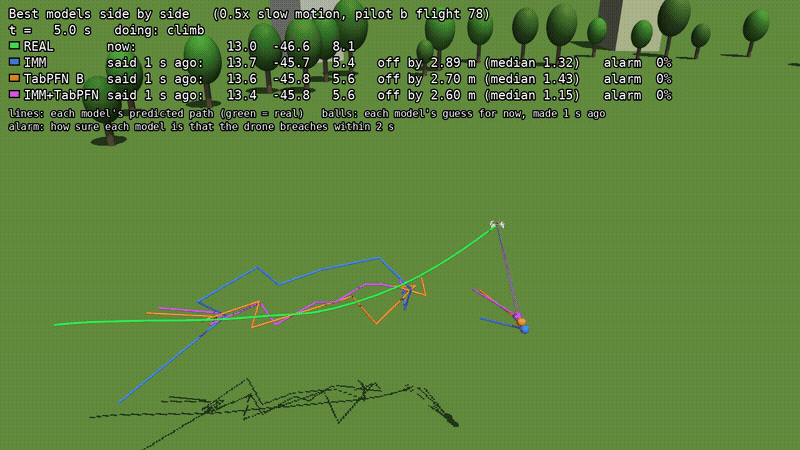

# priorlab_berlin_hack

HackLab #2 Berlin, Prior Labs track: **TabPFN for spatial awareness**. The brief is in [`docs/HACKATHON.md`](docs/HACKATHON.md).

## Drone track (this branch): where will the intruder drone be in 1 second?



A radar tracks a small intruder drone. **TabPFN predicts where it will be in 1 s and raises the alarm before it enters
the protected zone, with no training**: only example radar rows. We compare it with the IMM, the tracker real radars use.

| On a pilot no model has seen (250 flights) | Error 1 s ahead |
|---|---|
| IMM (radar standard) | 1.80 m |
| TabPFN B (no training) | 1.67 m |
| **IMM + TabPFN (TabPFN corrects the IMM)** | **1.62 m: 10% better than the IMM** |
| IMM + TabPFN live (correction every 0.3 s) | 1.72 m: 4% better |

- The idea in diagrams: [`drone/EXPLAINED.md`](drone/EXPLAINED.md)
- How to run and reproduce everything: [`drone/README.md`](drone/README.md)
- All results, charts and caveats: [`results/README.md`](results/README.md)
- Every experiment in detail: [`drone/EXPERIMENTS.md`](drone/EXPERIMENTS.md)

## Team setup

1. Clone the repo and add your TabPFN key:
   ```sh
   git clone https://github.com/Jaseelkt007/priorlab_berlin_hack.git
   cd priorlab_berlin_hack
   echo "TABPFN_TOKEN=<your key from platform.priorlabs.ai>" > .env   # git ignores .env
   ```
2. Install the shared Claude Code skills once per machine, so everyone gets the same `/potato-start` and `/potato-help` and the version reminder:
   ```sh
   git clone https://github.com/Jaseelkt007/potato-skills ~/potato-skills
   sh ~/potato-skills/install.sh
   ```
   Optional: the pstack skills it mentions, via `npx skills add backnotprop/pstack -g`.
3. Open Claude Code in this folder. The coding rules are already in `CLAUDE.md` (hackathon mode) and load automatically. Running `/potato-start hackathon` again is safe and changes nothing. **Never run it with another mode**: the block is shared, so a different mode changes the rules for the whole team.
