# Crane sway with TabPFN, explained in pictures

> **One line:** an overhead crane's load keeps swinging after every move. TabPFN predicts **where the load will be in
> 1 second** and, before each move, **which anti-sway setting gives the shortest safe cycle**. No training, only
> examples. On a real lab crane it got **3× more accurate after 5 s of a new load**; in a full-size MuJoCo crane the live
> pick and place learned the right anti-sway setting and ran **27% faster** than the typed-in setting.

Interactive explainer with all charts: https://claude.ai/artifact/7rjNJLFjPqkE2g74ekxL31

---

## 1. The problem

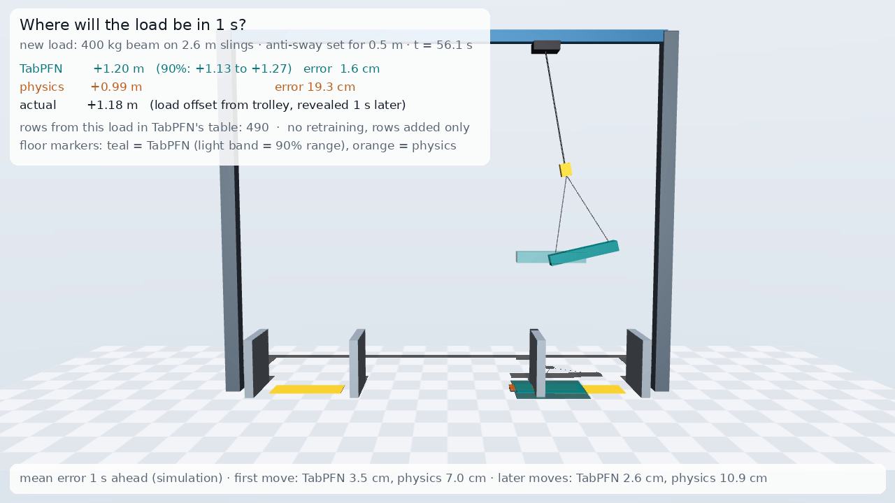

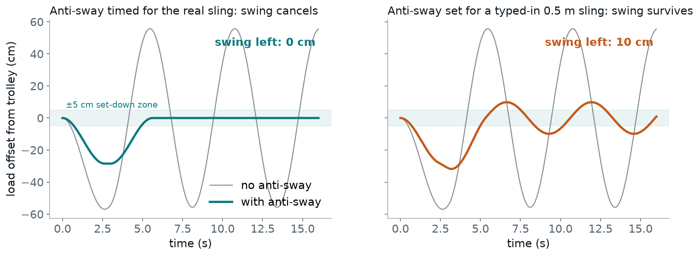

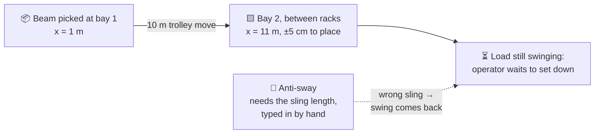

| Thing | Value | Why it matters |
|---|---|---|
| Rope (hoist) | 3–7 m, measured | sets how slowly the load swings |
| Sling (rigging) | 0.5–3 m, **never measured** | the anti-sway guesses it; wrong guess = 20+ s of waiting |
| Rack clearance | 0.45 m | a bigger swing hits the racks |
| Set-down rule | within ±5 cm for 1 s | the wait we want to shorten |

The anti-sway only knows the pendulum someone **typed in**. We want the crane to know how **this** load really swings.

---

## 2. The questions we answer

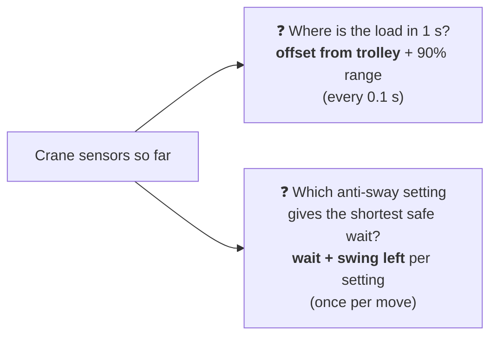

---

## 3. The pipeline

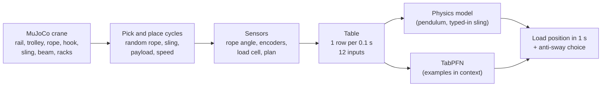

---

## 4. Learn on some loads, test on new ones

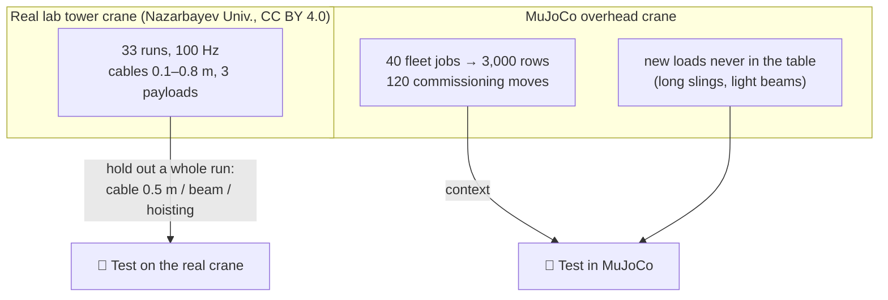

---

## 5. What one table row looks like

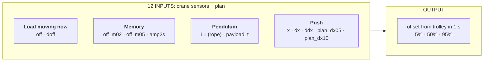

The sling length is **never** a column: TabPFN has to read it from how the load moves. The anti-sway choice uses a
second, smaller row: **sway period · speed · tuning error** → **wait** and **swing left**.

---

## 6. How TabPFN predicts (no training)

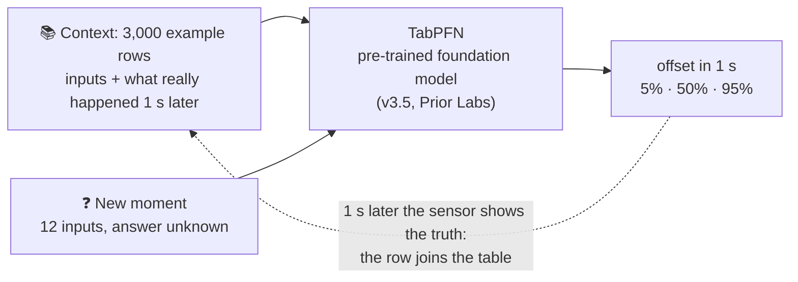

- **No training, no tuning:** "fit" stores the table; a new load is handled by adding its rows.
- **Every moment is predicted on its own**; the memory columns carry the recent history.
- **2 models:** the forecast (regression with a range) and the anti-sway choice (wait + swing, per setting).

---

## 7. The opponent: physics + anti-sway

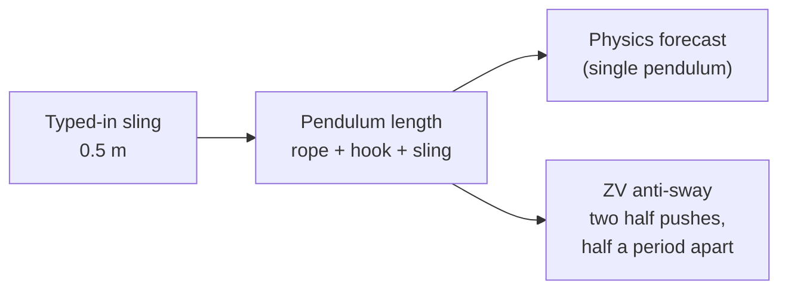

What cranes use today: exact if the length is right, wrong when the sling or the load shape differs.

---

## 8. Results

| Test | Physics / industry | TabPFN | Where |
|---|---|---|---|
| Forecast, new payload (beam), after 5 s of its rows | 0.54 cm (fitted pendulum) | **0.10 cm** (3× better), 90% range holds 91% | real lab crane |
| Forecast, hidden 2.5 m sling | 4.7 cm | **0.7 cm** | MuJoCo, 27 runs |
| Forecast, all 81 settings | 2.2 cm | **0.8 cm** | MuJoCo playground |
| 12 new loads, total time | 403 s | **261 s (−35%)** | MuJoCo closed loop |
| Live pick and place, 9 cycles | about 68 s / cycle | **49.6 s / cycle**, 7 of 9 OK | MuJoCo live |

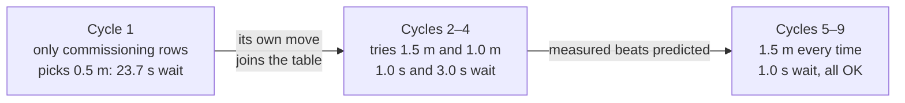

### Checks a judge will ask about

| Check | Answer |
|---|---|
| Real data? | The forecast is checked on a real lab crane; the full-size crane and closed loop are simulation. Every number says which. |
| Fair opponent? | Physics gets a fitted pendulum length on the lab crane; with the right sling it wins, and we show that. |
| Fewer inputs? | The forecast needs all 12 (5 nearly double the error); the anti-sway choice is as good with 3 (`ablation.py`). |
| Safer? | Not shown: nothing collided, so the gain is time. The 99% range is used as a "clear of the racks" rule. |
| What failed? | Timing the set-down alone: the position was right, but the load still moved at 15 cm/s. |

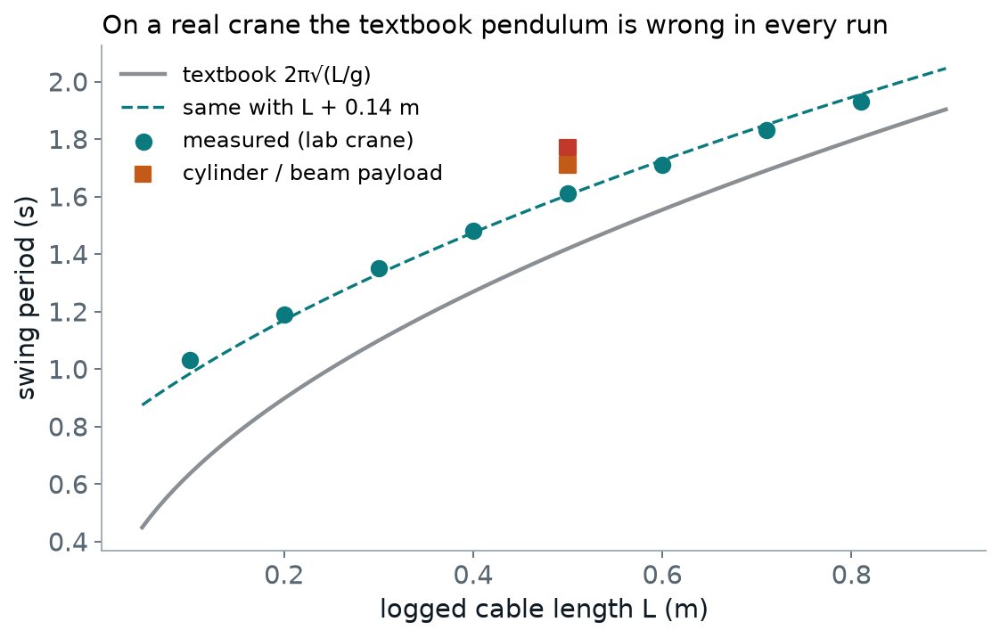
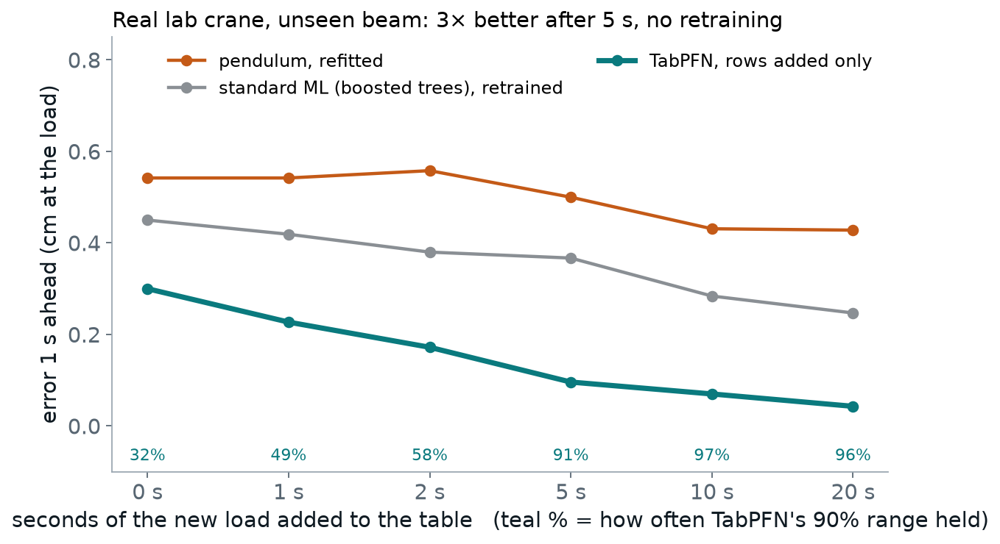
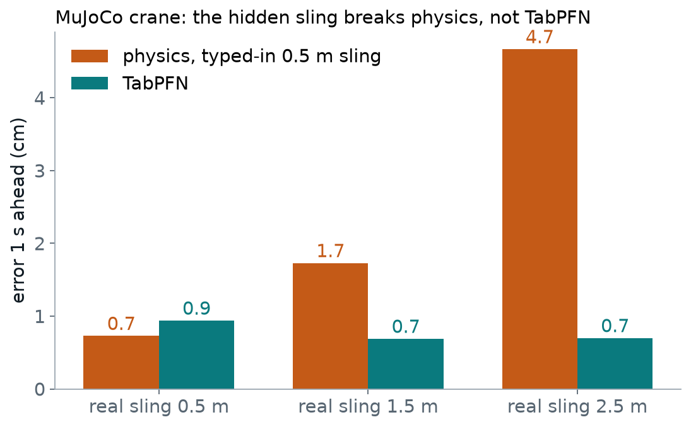
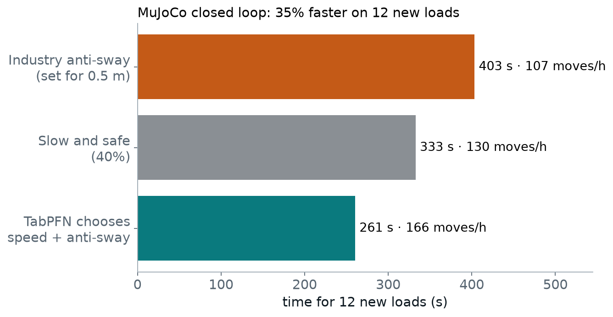
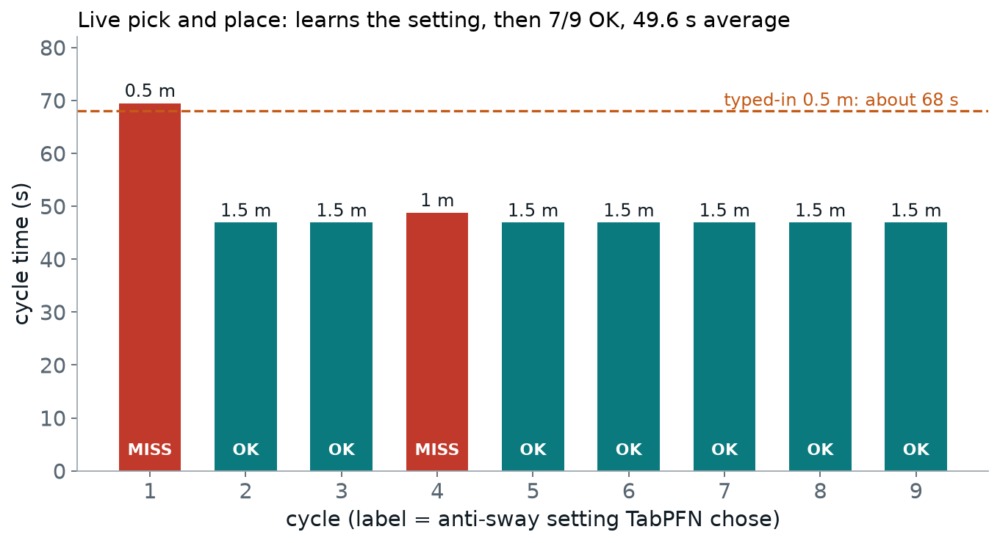

---

## 9. Try it

```sh
crane/run_live.sh                      # Linux / macOS: live pick and place, TabPFN chooses the anti-sway
powershell -File crane\run_live.ps1    # Windows
crane/.venv/bin/python crane/check_setup.py
```

---

The pitch slides and video script: [`PITCH.md`](PITCH.md). Figures: `figures/` (made by `make_figures.py`).
