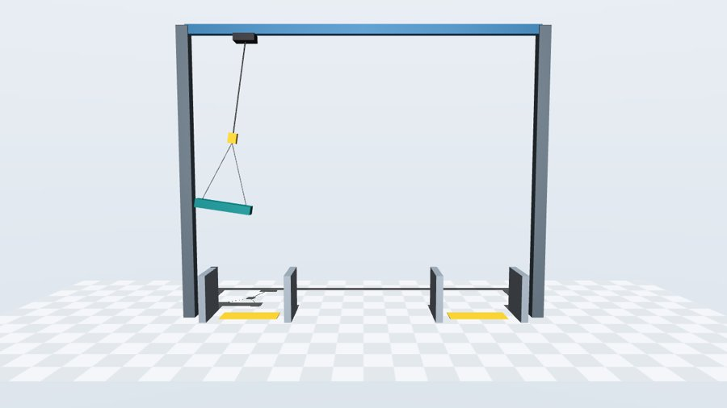
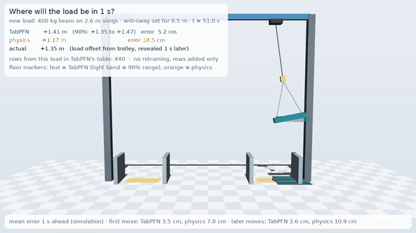
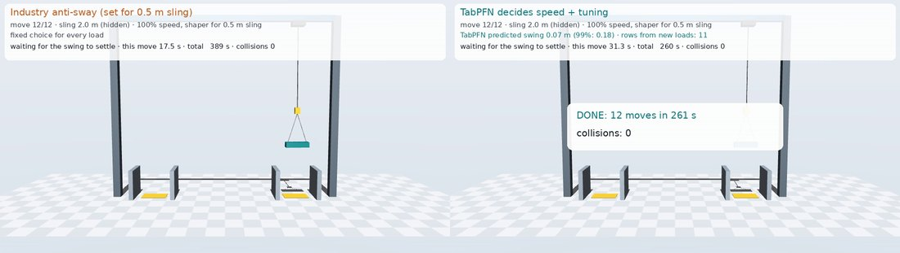
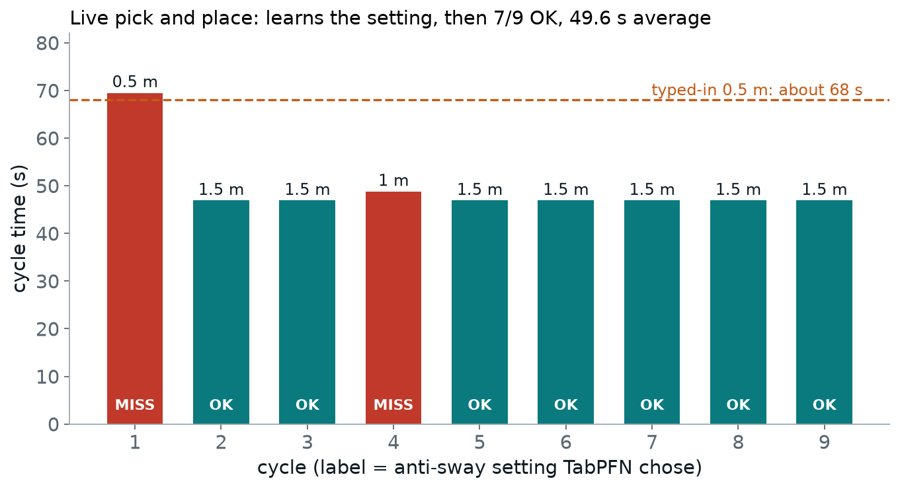
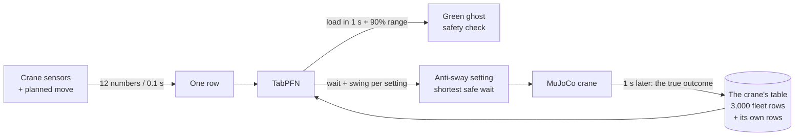

# Can a table steady a crane?

**HackLab #2 Berlin · Prior Labs track "TabPFN for spatial awareness" · 21–22 Nov 2026 · branch `crane`**

An overhead crane's load keeps swinging after every start and stop. Anti-sway control cancels the swing only if it knows the pendulum, including a sling length someone types in. We turned the crane's own sensors into a table (one row every 0.1 s) and asked **TabPFN**, a model that learns from the examples it is shown instead of from training, to predict where the load will be 1 s later and to choose the anti-sway setting for every load.

| Predicting the swing | Adapting to a new load | Choosing the anti-sway | Still fails |
|---|---|---|---|
| **5–7×** closer than physics, 1 s ahead (real lab crane: 0.10 vs 0.50 cm; full size: 0.70 vs 4.7 cm) | **3×** lower error after **5 s** of an unseen load's rows, no retraining (real lab crane) | **−35%** time on 12 new loads; live pick and place **47 s instead of 68 s** per cycle once learned | **timing the set-down alone**: the position is right, but the load still moves at 15 cm/s; early cycles pick wrong settings |

| The crane | Live forecast | TabPFN chooses the anti-sway | It learns in a few cycles |
|---|---|---|---|
|  |  |  |  |
| MuJoCo overhead crane: trolley, rope, hook, slings, 2 m beam, racks beside two bays | Ghost = TabPFN's predicted load position 1 s ahead, next to the physics model | Left: industry anti-sway set for the wrong sling; right: TabPFN choosing, done in 261 s vs 403 s | Live pick and place: wrong setting in cycle 1, right setting from cycle 5, 7 of 9 OK |

## Documentation

| Page | What it covers | Live | Source |
|---|---|---|---|
| **Crane Sway**: full project report | problem, what is predicted and TabPFN's role, physics and anti-sway, inputs and outputs with a glossary, real-crane and MuJoCo results, interactive playground, closed loop, live pick and place, limits, sources | [open](https://claude.ai/artifact/7rjNJLFjPqkE2g74ekxL31) | [`docs/report.html`](docs/report.html) |
| **Explained in pictures** | the whole idea in diagrams | | [`EXPLAINED.md`](EXPLAINED.md) |
| **Result files** | what each file in `results/` is and which script made it | | [`results/README.md`](results/README.md) |

Also: dataset search and credit [`DATASETS.md`](DATASETS.md), the Prior Labs lessons [`LESSONS.md`](LESSONS.md).

---

## The idea in four sentences

A crane already measures what a prediction needs: the rope angle, the trolley and hoist encoders, the load cell and its own planned move. We write those down as one row every 0.1 s and give the crane's past rows to TabPFN as examples. TabPFN then reads the live row and, by analogy with the examples, says where the load will be 1 s later (with a range), and before each move it predicts the wait for every anti-sway setting so the crane can take the shortest safe one. It predicts the swing far better than the physics model when the sling is unknown, and it adapts to a new load by adding rows, but timing the set-down alone does not work.

## Background

### Prior Labs and TabPFN

TabPFN (Tabular Prior-data Fitted Network) is a transformer pre-trained once on millions of synthetic tables. Given a table of example rows (the **context**), it predicts a missing column for new rows in a single forward pass, with no training loop and with a full predictive distribution.

| | |
|---|---|
| Model | TabPFN 3.5 (`n_estimators=1`), run locally on a GTX 1650 laptop GPU |
| Output | a distribution per prediction; we use quantiles 5 / 50 / 95% (forecast) and 50 / 99% (safety rule) |
| Speed | about 130 ms per live forecast; `fit_mode="fit_with_cache"` encodes the context once |
| What we never do | fine-tune it: its weights never change; adapting means adding rows |

### The crane, real and simulated

- **Overhead crane:** a trolley on a rail carries the load on a rope, a hook and slings. Every start and stop makes it swing like a (double) pendulum, period T = 2π√(L/g).
- **Anti-sway (ZV input shaping, Singer & Seering 1990):** each push is split into two half pushes, half a swing apart, so the swings cancel. It needs the pendulum length, including a **sling length someone types in**; typed 0.5 m, real 2.0 m leaves 10 cm of swing.
- **Real lab crane:** Nazarbayev University tower crane dataset, 33 runs at 100 Hz, cables 0.1–0.8 m, three payloads (CC BY 4.0).
- **MuJoCo crane:** rail, trolley, rope, hook, slings, 2 m beam, racks with 0.45 m clearance; a free beam for pick and place.

| Forecast inputs (12, every 0.1 s) | | Output | |
|---|---|---|---|
| swing now, 0.2 s and 0.5 s ago, rate, largest in 2 s | 5 | load offset from the trolley, 1 s ahead | 5 / 50 / 95% |
| trolley position, speed, acceleration | 3 | | |
| rope length, payload | 2 | | |
| planned trolley move over 0.5 s and 1 s | 2 | | |

The **sling length is never an input**: TabPFN reads it from how the load moves.

## How it works



### Data

| Source | What | Rows | Used for |
|---|---|---|---|
| Real lab crane | 13 trolley runs, 99 s each at 100 Hz | ~12,500 rows at 10 Hz | forecast on held-out runs (cable length, beam payload, hoisting) |
| MuJoCo fleet | 40 back-and-forth jobs, random rope / sling / payload / speed | 3,000 sampled | context for the live forecast |
| MuJoCo commissioning | 120 single moves with random anti-sway settings | 120 | context for the anti-sway choice |
| MuJoCo grid | 81 runs: rope × sling × payload × speed | 19,440 predictions | playground and parameter effects |

### One anti-sway decision

TabPFN predicts **one target column**, so each candidate setting is one query row; the crane asks once per move, while the beam is being lifted.

```
context row:  [sway period, speed, tuning error] -> wait, swing left      120 commissioning moves + this load's moves (x5)
query rows:   [measured period, speed, error for off, 0.5 ... 3.0 m]       7 rows -> wait + swing (50%, 99%) each
choice:       shortest (shaper delay + wait) whose 99% swing < 0.45 m      settings already tried on this load use their measured result
```

### Experiments

| Exp | Question | Mode | Script |
|---|---|---|---|
| 1 | Forecast 0.5 / 1 s ahead on held-out real-crane runs: physics vs trees vs TabPFN | offline, real data | `exp1_real.py` |
| 2 | Adapt to an unseen payload by adding rows; physics + TabPFN | offline, real data | `exp2_real.py` |
| 3 | Forecast on a full-size crane with a held-out load | MuJoCo | `mujoco_demo.py` |
| 4 | 81-setting grid; which parameters matter | MuJoCo | `playground_precompute.py`, `influence.py` |
| 5 | Which inputs can be dropped | offline | `ablation.py` |
| 6 | TabPFN chooses speed and anti-sway, 12 new loads | closed loop | `mujoco_closed_loop.py` |
| 7 | Time the set-down instead of killing the swing | offline | `setdown_advisor.py` |
| 8 | Live pick and place, TabPFN chooses the anti-sway | live window | `live_pick_place.py --auto-tune` |

## Results

**1 · Forecast on the real lab crane.** Mean error at the payload 1 s ahead (cm), whole runs held out:

| Held out | Fitted pendulum | Standard ML (boosted trees) | TabPFN | Physics + TabPFN |
|---|---|---|---|---|
| new cable length (0.5 m) | 0.34 | 1.30 | 1.52 | **0.19** |
| new payload (beam) | 0.57 | 0.48 | **0.35** | 0.36 |
| hoisting during travel | 0.82 | 1.20 | 0.81 | **0.78** |

**2 · Adapting to the unseen beam.** After 5 s of its rows: TabPFN 0.30 → **0.10 cm**, its 90% range from 32% to 91% reliable; trees 0.37 cm, refitted pendulum 0.50 cm.

**3–4 · Full-size crane (MuJoCo).** Over 81 settings: TabPFN **0.8 cm** vs physics 2.2 cm. Hidden 2.5 m sling: **0.7** vs 4.7 cm. Short sling (typed value right): physics wins, 0.73 vs 0.94 cm.

**5 · Inputs.** The forecast needs all 12 (5 "physics" inputs nearly double the error); the anti-sway choice is as good with 3 (sway period, speed, tuning error).

**6 · Closed loop, 12 new loads.**

| Strategy | Time | Moves / h | Mean wait | Collisions |
|---|---|---|---|---|
| Industry anti-sway (set for 0.5 m) | 403 s | 107 | 19.9 s | 0 |
| Slow and safe (40%) | 333 s | 130 | 1.5 s | 0 |
| **TabPFN chooses** | **261 s** | **166** | 7.4 s | 0 |

**7 · Timing the set-down.** TabPFN put the touchdown inside ±5 cm on 12/12 moves (physics 4/12), but every early touchdown still moved 13–15 cm/s sideways: not safe. The swing has to be killed.

**8 · Live pick and place** (real sling 2.0 m): 9 cycles, settings 0.5, 1.5, 1.5, 1.0, then 1.5 m for the rest; mean **49.6 s** vs about 68 s with the typed-in 0.5 m; 7 of 9 placed within ±5 cm.

**Limits:** real data is a lab-scale crane; the full-size results are simulation, one seed each; no strategy collided, so the gain shown is time, not safety; TabPFN-3.5 weights are non-commercial.

## Present the live demo from another laptop

Everything the demo needs is in this folder: the code, the cached tables TabPFN reads (`results/live_fleet_rows.json`, `results/pickplace_decision_fleet.json`) and launchers. Only your own TabPFN key stays out of git.

1. **Get the code:** `git clone https://github.com/Jaseelkt007/priorlab_berlin_hack.git && cd priorlab_berlin_hack && git checkout crane`
2. **Install uv** (once): https://docs.astral.sh/uv/getting-started/installation/
3. **TabPFN key:** log in at https://platform.priorlabs.ai, accept the **TabPFN-3.5** licence, copy your API key, and create `.env` in the repo root containing one line, `TABPFN_TOKEN=yourkey` (no quotes, no `< >`). `.env` is git-ignored.
4. **Start the demo.** The first run creates `crane/.venv`, installs the packages (needs internet, a few minutes) and downloads the TabPFN weights once.
   - Linux / macOS: `crane/run_live.sh`
   - Windows (PowerShell, in the repo folder): `powershell -ExecutionPolicy Bypass -File crane\run_live.ps1`
5. **Pre-flight check** (after the first start, before presenting): `crane/.venv/bin/python crane/check_setup.py` (Windows: `crane\.venv\Scripts\python.exe crane\check_setup.py`). Every line should say OK.

Options: `run_live.sh predict` = live forecast only; extra flags are passed through, e.g. `run_live.sh pick --stopped` (start idle, Enter to begin) or `--manual` (one cycle per Enter).

**Before you go on stage:** start the window 3–5 minutes early and let it run. The first cycles are TabPFN trying settings; from about cycle 5 it keeps the right one, and the cycle table (bottom right) shows the learning. An NVIDIA GPU makes the green forecast ghost smooth. Without one it runs on CPU and the ghost lags; everything else works. On macOS the launcher uses `mjpython`, which MuJoCo's viewer requires.

**In the window:** dark blue = real beam; green = TabPFN's predicted position in 1 s; orange = physics model with the typed-in 0.5 m sling. Top left: mode, state, current cycle timer. Top right: both forecasts, the last 1-s check, the anti-sway setting and what's expected for this move (TabPFN prediction, or measured if already tried on this load). Bottom right: every cycle's time, expected → actual wait, placement, OK/MISS.

## Run it

```sh
uv venv --python 3.12 crane/.venv
uv pip install --python crane/.venv/bin/python -r crane/requirements.txt
python3 -I crane/data_tools/download_dataset.py           # lab-crane data, 11 MB, CC BY 4.0
set -a; . ./.env; set +a; export TABPFN_NO_BROWSER=1       # TABPFN_TOKEN; accept the TabPFN-3.5 licence first
crane/.venv/bin/python crane/exp1_real.py                 # 3 held-out tests, 4 predictors (~2 min)
crane/.venv/bin/python crane/exp2_real.py                 # adaptation curve + physics+TabPFN (~5 min)
MUJOCO_GL=egl crane/.venv/bin/python crane/mujoco_crane.py --check --frame
MUJOCO_GL=egl crane/.venv/bin/python crane/mujoco_demo.py # fleet data, held-out job, TabPFN, video (~5 min)
MUJOCO_GL=egl crane/.venv/bin/python crane/mujoco_closed_loop.py   # closed loop, 3 strategies x 12 loads + video (~10 min)
MUJOCO_GL=egl crane/.venv/bin/python crane/playground_precompute.py # page playground data + fleet rows (~2 min)
MUJOCO_GL=egl crane/.venv/bin/python crane/render_clip.py --rope 5.2 --sling 2.8 --payload 0.7 --speed 0.9
MUJOCO_GL=glfw crane/.venv/bin/python crane/live_crane.py      # LIVE 3D window: TabPFN predicts 1 s ahead in real time
MUJOCO_GL=glfw crane/.venv/bin/python crane/live_pick_place.py # LIVE pick and place with anti-sway tuning keys
MUJOCO_GL=glfw crane/.venv/bin/python crane/live_pick_place.py --manual   # one cycle per Enter; --stopped starts idle
MUJOCO_GL=glfw crane/.venv/bin/python crane/live_pick_place.py --auto-tune # TabPFN chooses the anti-sway setting (key 3)
```

`python3 -I crane/exp1_real.py --no-ml` runs only the physics baselines, with the standard library.

## Files

| File | What |
|---|---|
| `real_data.py` | loads the lab-crane runs into 10 Hz rows (12 features, targets +0.5 s / +1.0 s); pendulum baseline |
| `exp1_real.py`, `exp2_real.py` | real-data experiments; results in `results/*.json` |
| `mujoco_crane.py`, `mujoco_demo.py` | MuJoCo overhead crane (rail, trolley, rope, hook, slings, beam), demo and video |
| `mujoco_closed_loop.py` | closed loop: TabPFN chooses speed and anti-sway tuning per move, vs. industry anti-sway |
| `live_pick_place.py` | **live pick and place**: hoist lowers, grabs the beam (weld), lifts, travels, settles, places it in the other bay, releases, repeats; Enter start/stop, 1 auto / 2 manual; ←/→ change the anti-sway's assumed sling (wrong 0.5 m: 69.5 s cycle; right 2.0 m: 47 s) |
| `live_crane.py` | **live** MuJoCo window: the crane shuttles between bays, TabPFN's 1-s-ahead ghost updates in real time; change rope/sling/payload/speed with keys (Up/Down, PgUp/PgDn, Home/End, Ins/Del) or by typing `rope 5` in the terminal |
| `playground_precompute.py`, `render_clip.py` | page playground (option A, 81 precomputed runs) and any-parameter MP4 clip (option B) |
| `make_figures.py` | slide figures in `figures/` from the saved results (no simulation needed) |
| `docs/` | `report.html` (the full project report) and `img/` (README pictures) |
| `data_tools/` | dataset download, the period check (measured vs. textbook pendulum), an xlsx reader |
| `DATASETS.md`, `LESSONS.md` | dataset search and citation; the four Prior Labs lessons with links |

## Data and credit

Lab tower-crane dataset: Alhassan, A., Arif, S. M. U., Talapiden, K., Shehu, M. A., Haruna, A., Do, T. (2025). *Trajectories and Payload Oscillations Data of Tower Crane Systems with varied Payload Masses, Shapes, and Cable Lengths for Machine Learning-Based Control, System Identification, and Industrial Automation*. Mendeley Data, V2. https://doi.org/10.17632/x69hyyv3zw.2, licensed CC BY 4.0. It is not stored in this repo: `data_tools/download_dataset.py` fetches it.
