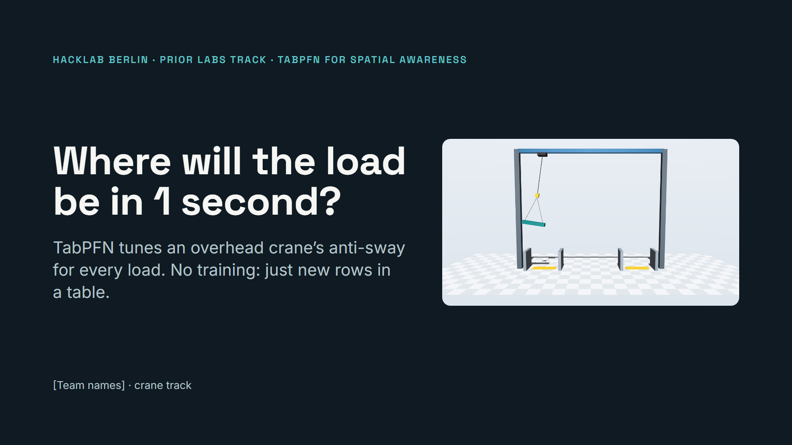
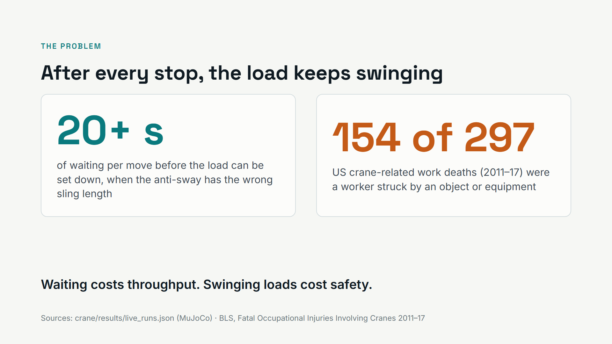
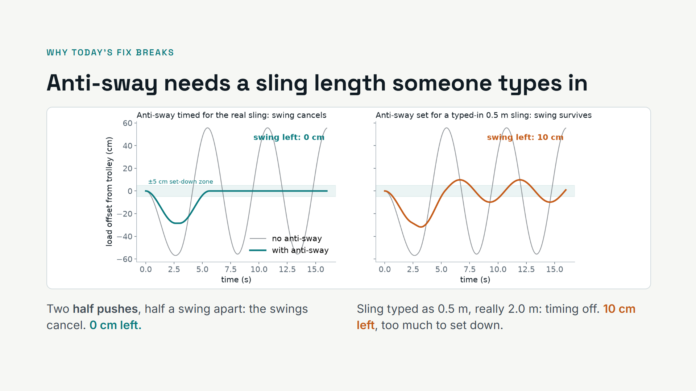
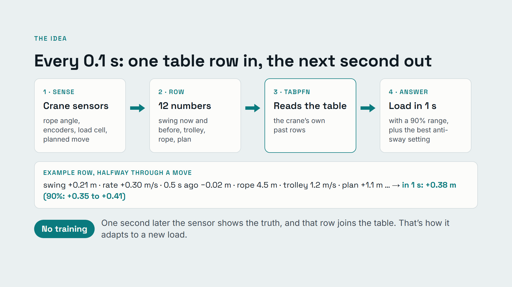
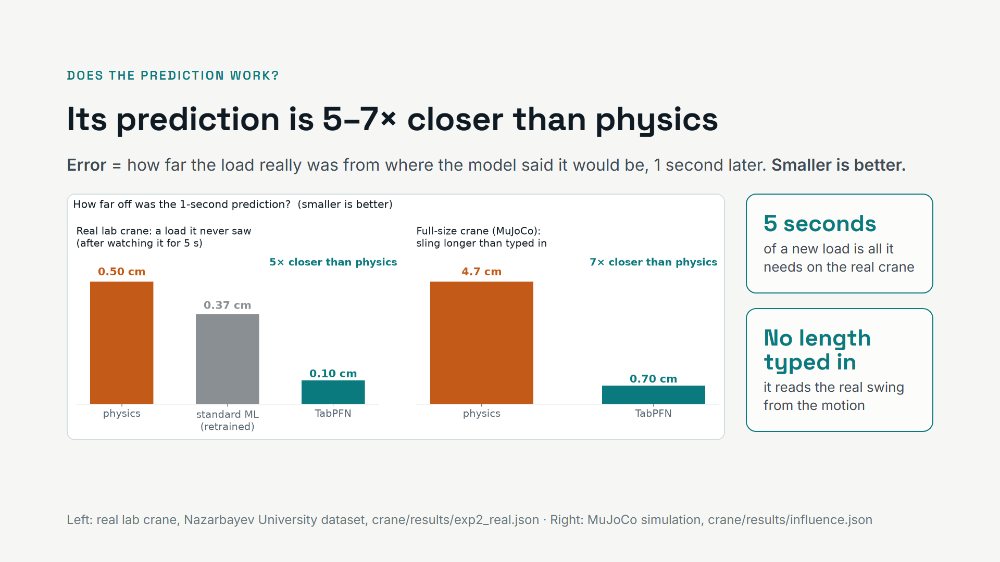
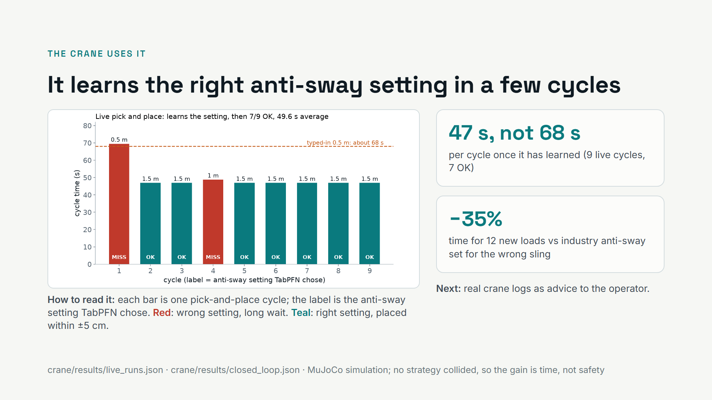

# Crane pitch: the 6 slides

The live deck (present, edit, export to PowerPoint or PDF): https://claude.ai/artifact/4EJUDBdYFHaYS2yYs6DnKQ (private until shared).  
Offline copy: [`crane_pitch.pdf`](crane_pitch.pdf). Outline with sources and the 3-minute video script: [`../PITCH.md`](../PITCH.md).

Below: each slide, then what to say (the speaker notes).

## 1. Where will the load be in 1 second?

**Say:** Our crane idea in one line: a crane’s load keeps swinging after every move, and anti-sway fixes that only if someone types in the right sling length. TabPFN learns the swing from the crane’s own recent moves and picks the anti-sway setting itself. No training, just new rows.

## 2. After every stop, the load keeps swinging

**Say:** When an overhead crane stops, the load keeps swinging. The operator has to wait before setting it down: in our simulation that’s more than 20 seconds per move when the anti-sway is set for the wrong sling. And a swinging load is dangerous: in the US, 154 of 297 crane-related work deaths from 2011 to 2017 were workers struck by an object or equipment.

## 3. Anti-sway needs a sling length someone types in

**Say:** Anti-sway cancels the swing with two half-sized pushes, half a swing apart: the second push starts an equal swing in the opposite phase, so they cancel. Left: timed for the real sling, nothing is left. But the timing depends on the pendulum length, including a sling length the operator types in. Right: typed in as 0.5 metres when it’s really 2 metres, the second push comes too early and 10 centimetres of swing survive, which is more than the 5-centimetre set-down limit, so the crane waits.

## 4. Every 0.1 s: one table row in, the next second out

**Say:** We turn the crane’s own sensors into a table: the swing now and a moment ago, the trolley, the rope, the planned move. That’s 12 numbers every tenth of a second. TabPFN, pretrained once by Prior Labs, reads the crane’s table of past rows plus the current row and answers where the load will be one second later, with a range. Before each move it also predicts the wait for every anti-sway setting, and the crane takes the shortest safe one. There’s no training: one second later the sensor shows the truth, and that row joins the table.

## 5. Its prediction is 5–7× closer than physics

**Say:** Before the crane acts on anything, we need to know the prediction is good. The question is simple: TabPFN said the load would be here in one second; how far off was it? Smaller is better. Left: real data from a lab crane, with a load TabPFN had never seen. After watching it for just five seconds, TabPFN is five times closer than the physics model, and better than standard machine learning that we retrained on the same data. TabPFN needed no training at all. Right: a full-size crane in simulation, where the sling is longer than the operator typed in. Physics is off by almost 5 centimetres, TabPFN by 0.7. The physics model is only as good as the length someone typed in. TabPFN reads the real swing from the motion itself.

## 6. It learns the right anti-sway setting in a few cycles

**Say:** Now the crane acts on the predictions. Before each move, while the beam is lifted, TabPFN predicts the wait for every anti-sway setting and the crane takes the shortest safe one. Each bar is one cycle. Cycle 1: with only commissioning data it picks the wrong setting and waits 24 seconds. Cycle 4: it tries a setting it hasn’t tested yet, which also misses. From cycle 5 it keeps the right one: 47 seconds per cycle instead of 68, every placement within 5 centimetres. Over twelve new loads it is 35% faster than industry anti-sway set for the wrong sling. It runs on a laptop GPU, about 130 milliseconds per prediction, and the choice happens while the beam is being lifted. Honest limits: the full-size crane is simulation, the real data is a lab crane, and nothing collided, so this is a time gain, not a safety claim yet. Next: real crane logs, as advice to the operator first. Physics where it’s known, TabPFN where the load surprises you.
