# Drone defence with TabPFN, explained in pictures

> **One line:** a radar sees an intruder drone. TabPFN predicts **where it will be in 1 second** and **whether it
> breaks into the protected zone within 2 seconds**. No training, only examples, and it beats the radar industry's
> standard tracker (IMM) by **8%**, even after the IMM is re-tuned on the same data and against a pilot it never saw.

---

## 1. The problem

A radar knows where a drone **is**. To stop it, you need where it **will be**, and a small drone can change course within a second. This matters wherever small drones are a threat: airports, stadiums, power plants, prisons.

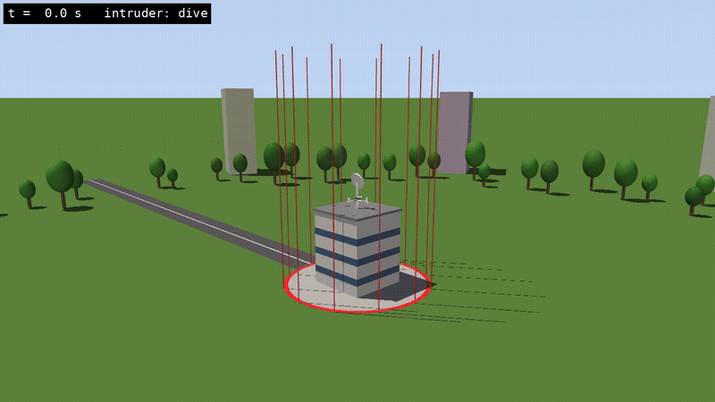

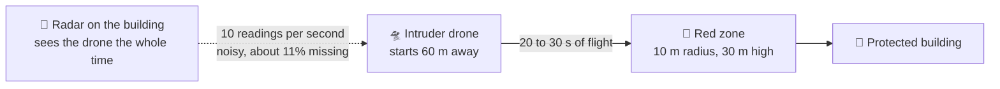

| Circle | Size | Job |
|---|---|---|
| Radar coverage | 60 to 70 m | **see** the drone |
| Red zone | 10 m | **no-go area**: entering it is a *breach* |
| Gap between them | 20 to 30 s | **time to predict and warn** |

The radar only says where the drone **is**. We want to know where it **will be**.

---

## 2. The questions we answer at every radar reading

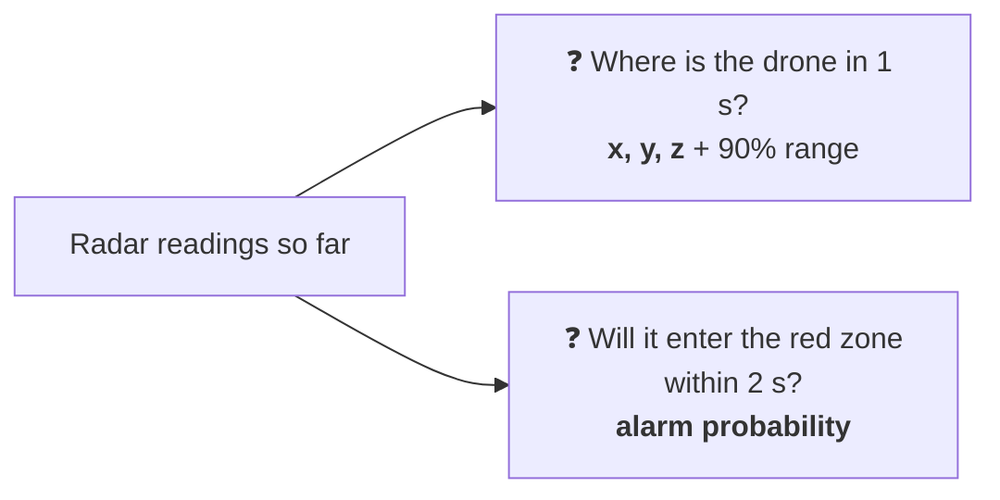

---

## 3. The pipeline

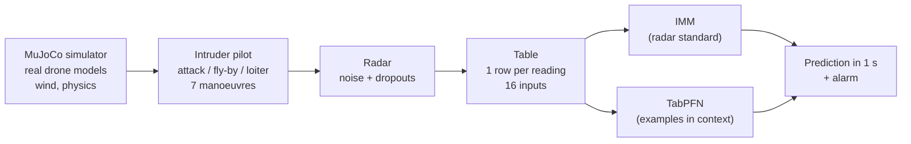

---

## 4. Two drones: learn on one, test on the other

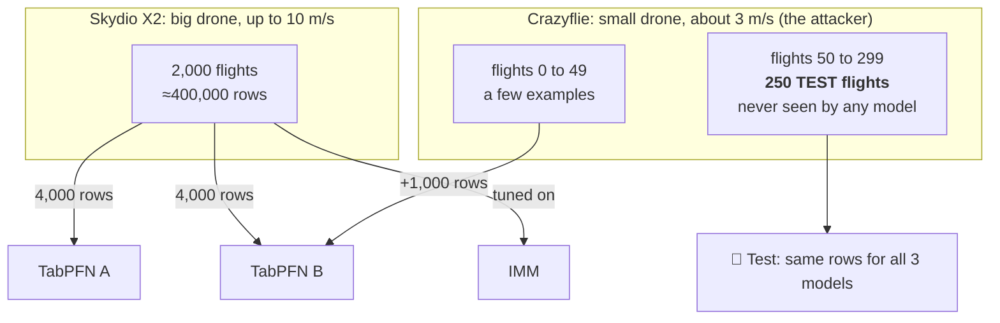

---

## 5. What one table row looks like

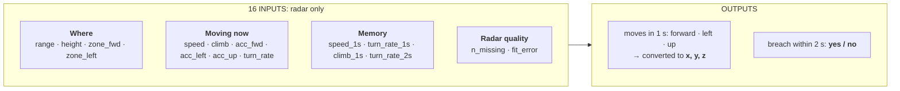

The movement is learned in the **drone's own frame** (forward, left, up), so a turn to the left looks the same in
every direction. We convert back to x, y, z for scoring and the video.

---

## 6. How TabPFN predicts (no training)

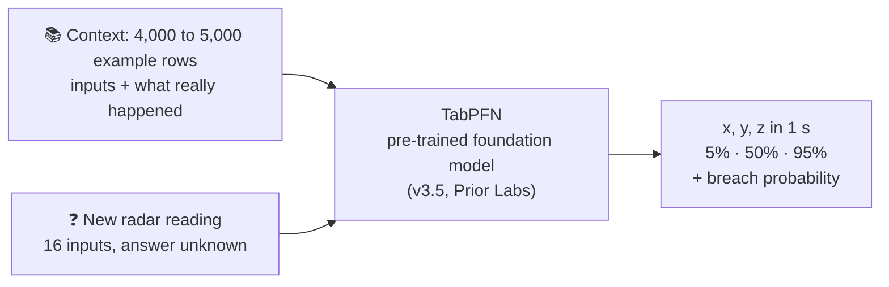

- **No training, no tuning:** the examples are given to it, like showing a person a few cases.
- **Every reading is predicted on its own**; the "memory" columns carry the recent history.
- **4 models in total:** forward, left and up (regression with a range), plus the alarm (classification).

---

## 7. The opponent: IMM

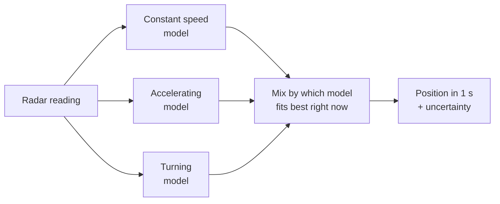

This is what real radar trackers use. It is physics with 5 hand-set knobs, which we tuned on the big drone.

---

## 8. Results (250 test flights, 112,501 moments)

| Model | Error 1 s ahead | New pilot (never seen) | Breaches caught |
|---|---|---|---|
| IMM (radar standard), tuned on big drone | 1.54 m | 1.80 m | 99% |
| IMM re-tuned on the same small-drone flights | 1.50 m | 1.82 m | 98% |
| TabPFN A (big drone examples only) | 1.70 m | 2.25 m | 95% |
| **TabPFN B (+ 1,000 small drone examples)** | **1.37 m** ✅ | **1.67 m** ✅ | 98% |

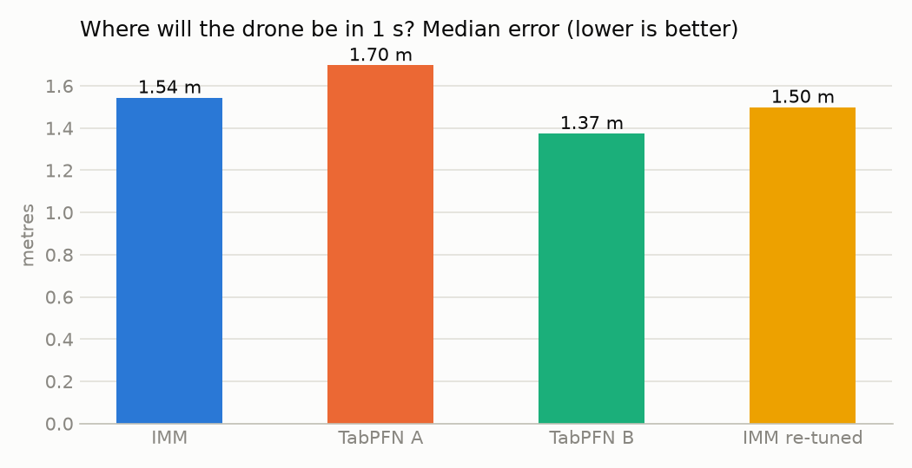

### Three checks a judge will ask about

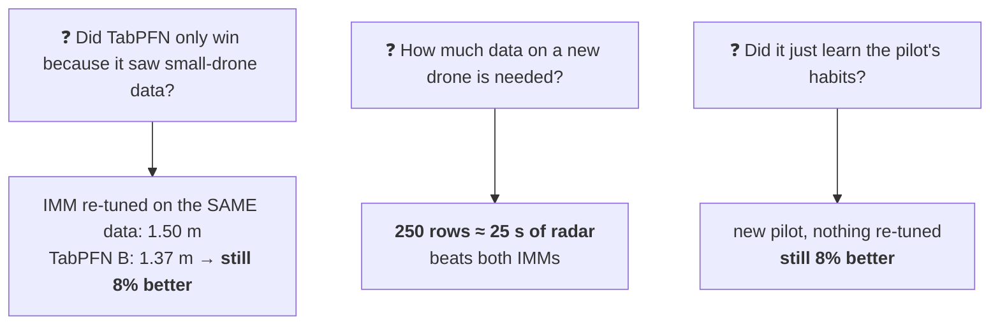

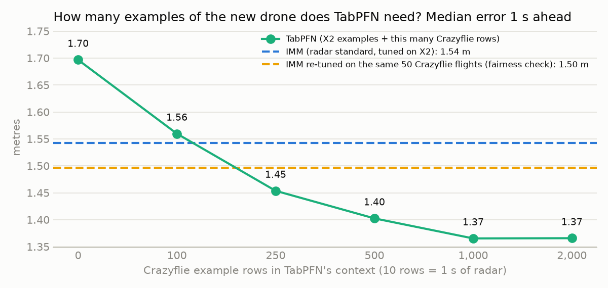

- **Better on:** straight, zigzag, orbit, hover, dash. **Slightly worse on:** dive, climb.
- **Alarm:** all models are near perfect at 2 s (AUC 0.99).
- **In the 250 test flights 108 drones breached**; TabPFN B warned for 98% of them, about 4 s before.
- **The gain is solid:** resampling the 250 flights 1,000 times keeps it between 7% and 10%.

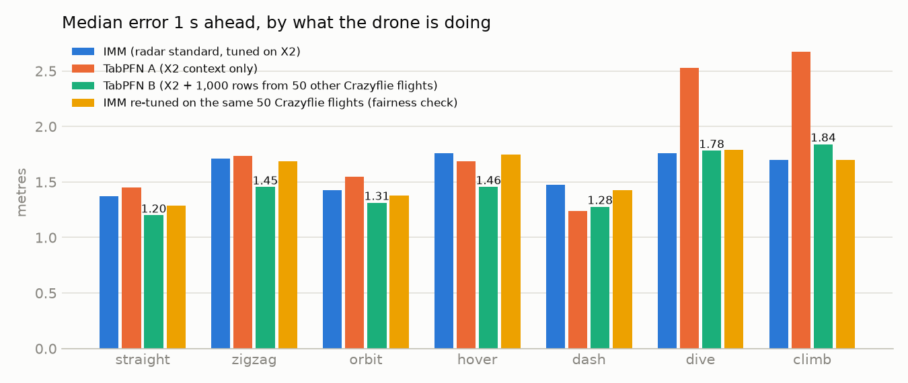

---

### IMM + TabPFN: TabPFN corrects the tracker the radar already runs

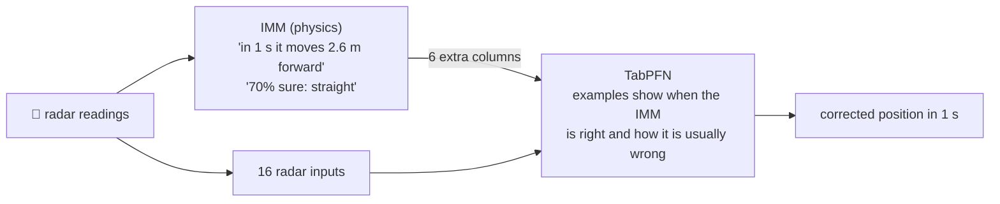

| On pilot b (never seen) | Error 1 s ahead |
|---|---|
| IMM | 1.80 m |
| TabPFN B | 1.67 m |
| **IMM + TabPFN** | **1.62 m: 10% better than the IMM**, better on 232 of 250 flights |

---

### Live: does it still work in real time?

TabPFN needs 252 ms per answer, the radar reads every 100 ms. So the IMM tracks every 0.1 s and TabPFN sends a new correction every 0.3 s.

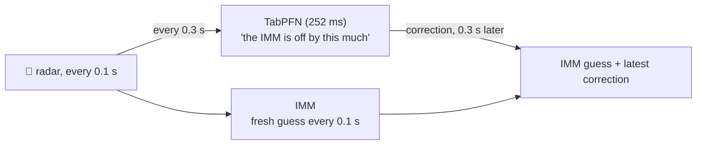

| On pilot b | Error 1 s ahead |
|---|---|
| IMM alone | 1.80 m |
| IMM + TabPFN, an answer at every reading (not live) | 1.56 m: 13% better |
| **Live: correction every 0.3 s** | **1.72 m: 4% better**, on 201 of 250 flights |

**The gap is speed, not accuracy:** a faster TabPFN gets back toward 13%.

---

## 9. See it

| Colour | Meaning |
|---|---|
| 🟢 green line | the real path |
| 🔵 blue | IMM's predicted path; its ball = its guess for *now*, made 1 s ago |
| 🟠 orange | TabPFN B |
| 🟣 purple | IMM + TabPFN |

All videos (not in git; `drone/make_videos.sh` makes them): list in `drone/results/README.md`, "Videos".

---

## 10. In a real system

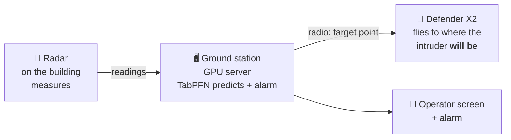

In our video the X2 defender only hovers. Flying it to where the intruder **will be** is what the predictions enable; building that is the next step.

---

## 11. Honest limits

| Limit | What we say |
|---|---|
| Simulation only | real drone models and physics, realistic radar; real radar data is next |
| Close range (60 m) | close-in defence: the last 20 to 30 seconds |
| Scripted pilots | two styles tested (TabPFN wins on both); human pilots are next |
| Example rows are scattered | "25 s of radar" means rows from 50 flights, not one continuous track |
| Perfect example answers | in real use "where it really went" comes from smoothed radar tracks of past flights, slightly noisier; the live drone's future is never shown |
| Speed | measured: 5.2 s → **252 ms per reading** with TabPFN's example cache and 1 pass, no accuracy lost; not yet under the radar's 100 ms, so live the IMM tracks and TabPFN corrects every 0.3 s: 4% better than the IMM instead of 13% |

---

**Run it:** `drone/README.md` · **all numbers:** `drone/results/README.md` · **every experiment:** `drone/EXPERIMENTS.md`
