# Drone defence with TabPFN, explained in pictures

> **One line:** a radar sees an intruder drone. TabPFN predicts **where it will be in 1 second** and **whether it
> breaks into the protected zone within 2 seconds**. No training, only examples, and it beats the radar industry's
> standard tracker (IMM) by **11%**.

---

## 1. The problem

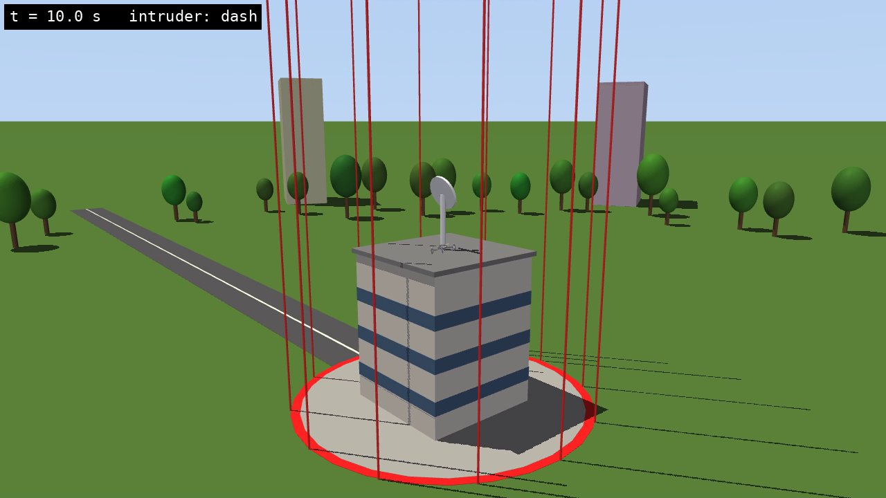

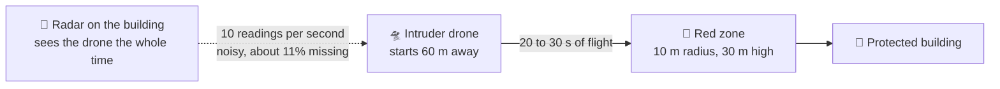

| Circle | Size | Job |
|---|---|---|
| Radar coverage | 60 to 70 m | **see** the drone |
| Red zone | 10 m | **no-go area**: entering it is a *breach* |
| Gap between them | 20 to 30 s | **time to predict and warn** |

The radar only says where the drone **is**. We want to know where it **will be**.

---

## 2. The questions we answer at every radar reading

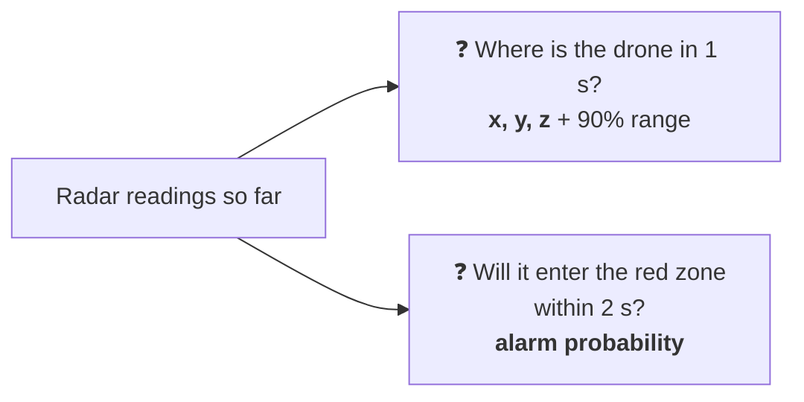

---

## 3. The pipeline

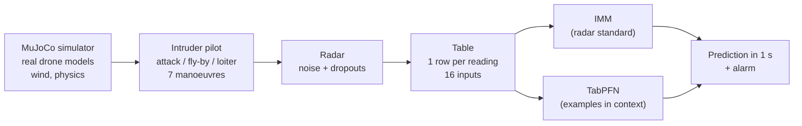

---

## 4. Two drones: learn on one, test on the other

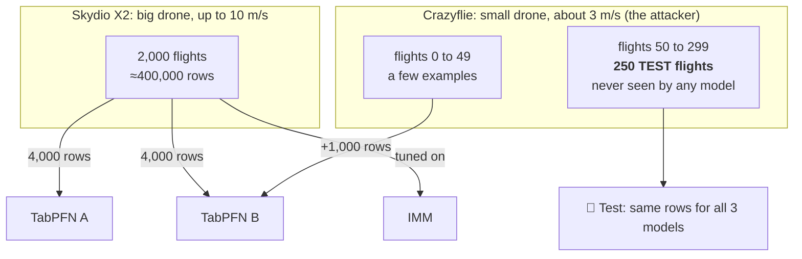

---

## 5. What one table row looks like

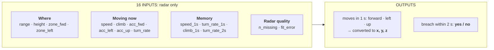

The movement is learned in the **drone's own frame** (forward, left, up), so a turn to the left looks the same in
every direction. We convert back to x, y, z for scoring and the video.

---

## 6. How TabPFN predicts (no training)

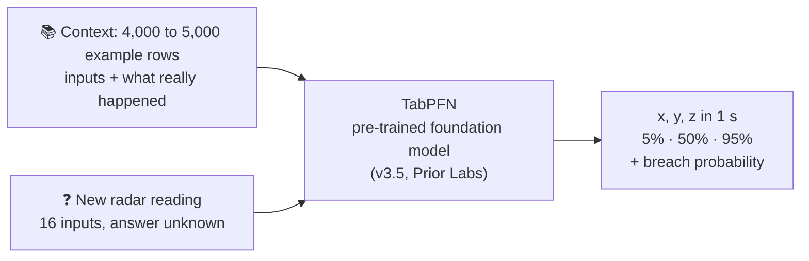

- **No training, no tuning:** the examples are given to it, like showing a person a few cases.
- **Every reading is predicted on its own**; the "memory" columns carry the recent history.
- **4 models in total:** forward, left and up (regression with a range), plus the alarm (classification).

---

## 7. The opponent: IMM

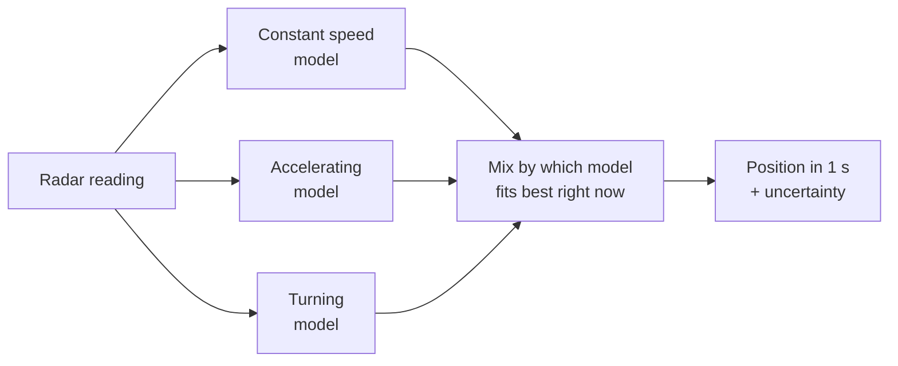

This is what real radar trackers use. It is physics with 5 hand-set knobs, which we tuned on the big drone.

---

## 8. Results (250 test flights, 112,501 moments)

| Model | Error 1 s ahead | Breaches caught | Warning before breach |
|---|---|---|---|
| IMM (radar standard) | 1.54 m | 99% | 3.9 s |
| TabPFN A (big drone examples only) | 1.70 m | 95% | 4.5 s |
| **TabPFN B (+ 1,000 small drone examples)** | **1.37 m** ✅ | 98% | 4.4 s |

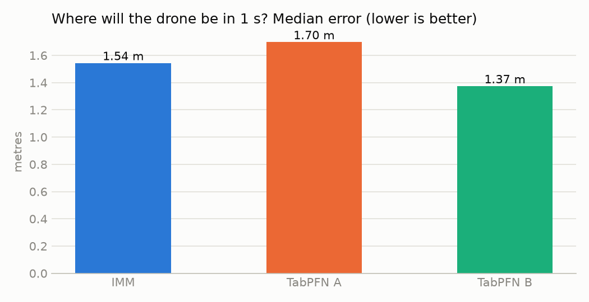

- **Better on:** straight, zigzag, orbit, hover, dash. **Slightly worse on:** dive, climb.
- **Alarm:** all models are near perfect at 2 s (AUC 0.99).
- **In the 250 test flights 108 drones breached**; TabPFN B warned for 98% of them, about 4 s before.

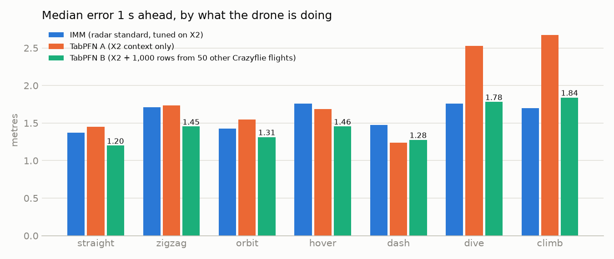

---

## 9. See it

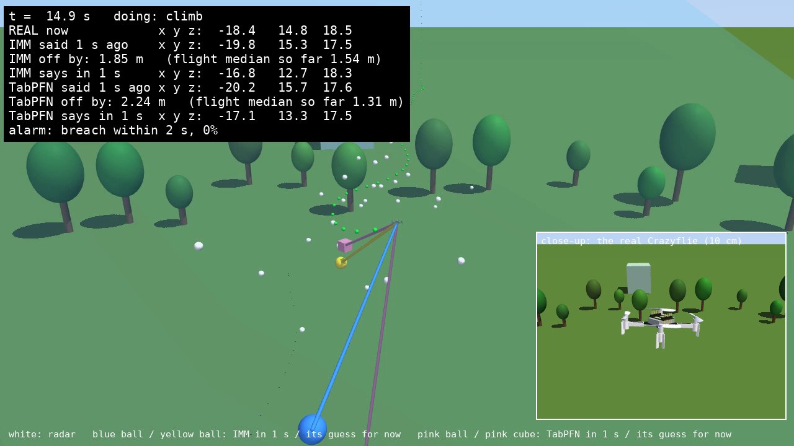

| Colour | Meaning |
|---|---|
| ⚪ white dots | radar readings |
| 🟢 green dots | the real path |
| 🔵 blue ball / 🟡 yellow ball | IMM: in 1 s / its guess for *now*, made 1 s ago |
| 🩷 pink ball / pink cube | TabPFN: in 1 s / its guess for *now*, made 1 s ago |

Videos (shared separately, not in git): `scene_54.mp4`, `imm_vs_tabpfn_chase_54.mp4`, `imm_vs_tabpfn_54.mp4`.

---

## 10. In a real system

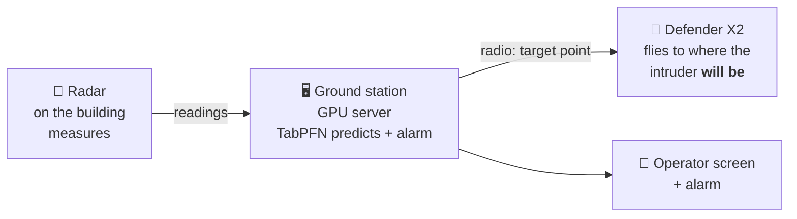

In our video the X2 defender only hovers; using the predictions to intercept is the next step.

---

## 11. Honest limits

| Limit | What we say |
|---|---|
| Simulation only | real drone models and physics, realistic radar; real radar data is next |
| Close range (60 m) | close-in defence: the last 20 to 30 seconds |
| One scripted pilot | other pilot styles and humans are next |
| IMM tuned on the big drone only | fairness check: re-tune it on the same 50 small-drone flights |
| Speed measured in batch | real-time delay per reading is not measured yet |

---

**Run it:** `drone/README.md` · **all numbers:** `results/README.md` · **every experiment:** `drone/EXPERIMENTS.md`
