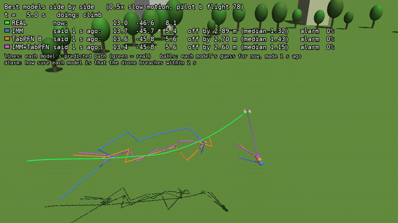

# Drone track: where is the intruder drone going?

**New to the project? Start with [`EXPLAINED.md`](EXPLAINED.md): the whole idea in diagrams.**



*Green: where the drone really went. Blue: the IMM (what radars use). Orange: TabPFN. Purple: IMM + TabPFN, our best.
Each line is where the model said the drone would be, 1 s earlier.*

Part of our Prior Labs entry ("TabPFN for spatial awareness"). Branch: `drone`.
Full detail and every experiment: [`EXPERIMENTS.md`](EXPERIMENTS.md).

## The idea

A radar knows where a drone **is**. To stop it, you need where it **will be**, and a small drone can change course within a second. This matters wherever small drones are a threat: airports, stadiums, power plants, prisons.

A small drone flies toward a protected site. A radar sees it, but the readings are noisy and sometimes missing.

**TabPFN predicts where the drone will be in 1 second, with a range ("it will be somewhere in this cone"), and raises the alarm before it reaches the site.** It has never seen this kind of drone before; it adapts from a few radar readings, without retraining.

We compare it with what real radar trackers use: an **IMM**, three Kalman-type filters (straight, speeding up, turning) that switch automatically.

## How it works

1. **A simulated sky** (MuJoCo): a red protected zone in the middle, a radar at its centre.
2. **Intruder flights**: a script flies drones toward the zone, randomly attacking, passing by or circling, with zigzags, dives, dashes and wind.
3. **Radar recording**: 10 positions a second, with noise and gaps.
4. **Tables**: each radar reading becomes one row: what the radar sees now (inputs) and where the drone really went next (answers).
5. **Models** learn from the big drone's flights and are tested on the small drone's.

| Drone | Role |
|---|---|
| Skydio X2 (big, 10 m/s) | flights to learn from (2,000); later the defender |
| Crazyflie (small, 3 m/s) | the attacker we test on (300 flights) |

## Inputs and outputs

**Inputs** (16 numbers, from the radar only): where the drone is relative to the zone, how fast it goes, whether it is turning, climbing or speeding up, the same a second or two ago, and how many radar readings were missing.

**Output**: where it will be in 1 s, as x, y, z (with a range), and **alarm**: will it enter the zone within 2 s?

## Status

| | |
|---|---|
| Simulation, both drones, intruder flights | done |
| Data: 2,000 X2 flights, 300 Crazyflie flights | done |
| Tables | done |
| IMM tracker (what real radars use) | done: tuned on X2, and re-tuned on Crazyflie flights 0-49 for a fair check |
| TabPFN | done (run on an H100; 1 minute) |
| Fairness check, example sweep, new pilot | done (experiments 12-14) |
| IMM + TabPFN (TabPFN corrects the IMM) | done: 10% better than the IMM on the new pilot (experiment 15) |
| Speed per radar reading | 5.2 s → 252 ms (H100, example cache); radar budget is 100 ms (experiment 16) |
| Live replay (IMM every 0.1 s, TabPFN every 0.3 s) | done: 4% better than the IMM (experiment 17) |
| TabPFN fine-tuned | dropped: the point is "no training" |
| 3D demo: real vs predicted x, y, z + alarm, live or as video | done for the IMM and TabPFN |
| Pitch videos: every model, and the best three together (+ GIF) | done (`make_videos.sh`, experiment 18) |

## Results so far

250 small-drone test flights per pilot. Error = how far the prediction for 1 s ahead is from where the drone
really was (median). Pilot a flew every example; pilot b is a more evasive pilot no model has seen.

| Model | Error, pilot a | Error, pilot b (new) | Alarm: breaches caught (a / b) |
|---|---|---|---|
| IMM (what real radars use), tuned on X2 | 1.54 m | 1.80 m | 99% / 100% |
| IMM re-tuned on the same 50 Crazyflie flights as TabPFN B | 1.50 m | 1.82 m | 98% / 97% |
| TabPFN A (examples from X2 only) | 1.70 m | 2.25 m | 95% / 85% |
| **TabPFN B (X2 + 1,000 rows from 50 other Crazyflie flights)** | **1.37 m** | **1.67 m** | 98% / 96% |
| **IMM + TabPFN (the IMM's answer as 6 extra inputs)** | | **1.62 m** | - / 97% |
| IMM + TabPFN live: TabPFN's correction every 0.3 s (fast setting) | | 1.72 m | not scored |

**With the same Crazyflie data and no training, TabPFN B is 8% more accurate than the IMM** (pilot a: 1.37 vs 1.50 m;
pilot b: 1.67 vs 1.80 m; better on 208 and 217 of 250 flights). About **250 Crazyflie rows (25 s of radar)** are
enough to beat both IMMs. **IMM + TabPFN**, where TabPFN corrects the IMM, is **10% better than the IMM** on pilot b.
Live (TabPFN needs 252 ms, so it corrects every 0.3 s) it keeps **4%**: the gap is speed, not accuracy.
**It knows when it is unsure:** TabPFN B's 90% range holds the real position 93% of the time on pilot a and 90% on pilot b, as promised; the IMM re-tuned on the small drone only 82% (pilot a).
The alarm is about a tie. Full analysis, charts and caveats:
[`../results/README.md`](../results/README.md).

## Try it

From the repo root, with Python 3.12 and `pip install -r drone/requirements.txt` (the exact versions used). First get
the drone models: see `models/README.md`. TabPFN needs `TABPFN_TOKEN` in `.env` (repo root README) and a GPU.

```sh
python drone/view_drones.py                      # fly the two drones with the keyboard
python drone/intruder.py --drone cf2 --view 54   # building, red zone, an intruder, the X2 defender hovering
python drone/demo_imm.py --view radar --tabpfn   # a test flight live: real vs IMM and TabPFN predictions
python drone/pitch_video.py --pilot b --flight 78 --model imm,tabpfn,combo --out results/videos/compare.mp4
```

Videos render offscreen, so a GPU server works: prefix `MUJOCO_GL=egl`. `drone/make_videos.sh` makes every video.

## Reproduce every result

The data is not in git (402 MB). Run these in order from the repo root; times are for a laptop CPU (simulation) and
an H100 (TabPFN). Every number in `results/` then comes from the last command.

```sh
# 1. flights (MuJoCo) and tables
python drone/intruder.py --flights 2000                          # X2 flights, 16 min
python drone/intruder.py --drone cf2 --flights 300               # Crazyflie flights, pilot a, 15 min
python drone/intruder.py --drone cf2 --pilot b --flights 250     # Crazyflie flights, pilot b (never in the examples)
python drone/features.py                                         # tables, 30 s each
python drone/features.py --drone cf2
python drone/features.py --drone cf2_pilotb

# 2. the IMM (the radar standard)
python drone/imm.py --drone x2                                   # X2 tuning; also the combo's examples
python drone/imm.py --drone cf2
python drone/imm.py --drone cf2_pilotb
python drone/imm.py --tune --drone cf2                           # optional: re-finds TUNED_CF2 (already in imm.py)
python drone/imm.py --drone cf2 --settings cf2                   # fairness check: IMM tuned on Crazyflie flights 0-49
python drone/imm.py --drone cf2_pilotb --settings cf2

# 3. TabPFN (needs TABPFN_TOKEN; GPU)
python drone/tabpfn_model.py --every 1                                                    # A and B, pilot a
python drone/tabpfn_model.py --versions A,B --test cf2_pilotb --every 1 --out data/tabpfn_cf2_pilotb.npz
python drone/tabpfn_model.py --versions B --imm-features --test cf2_pilotb --every 1 --out data/tabpfn_cf2_pilotb_combo.npz
python drone/tabpfn_model.py --versions B --imm-features --fast --context 1000 --adapt-rows 1000 \
    --test cf2_pilotb --every 1 --batch 10000 --out data/tabpfn_cf2_pilotb_combo_fast.npz  # live replay
for n in 0 100 250 500 1000 2000; do                                                      # example sweep
    python drone/tabpfn_model.py --versions B --adapt-rows $n --out data/sweep/B_$n.npz
done
python drone/latency.py                                          # speed per radar reading -> results/latency.csv

# 4. results and videos
python drone/report.py                                           # results/README.md, CSVs, charts
MUJOCO_GL=egl drone/make_videos.sh                               # results/videos/, world.gif and compare.gif
```

## Project tree

```
priorlab_berlin_hack/
├── README.md                 the front page: the idea and the headline results
├── DEBT.md                   quick fixes taken during the hackathon, and their real fix
├── docs/                     hackathon brief and background research
├── drone/                    all code and the drone docs
│   ├── README.md             this page: how to run, and how to reproduce every result
│   ├── EXPLAINED.md          the whole idea in diagrams (start here)
│   ├── EXPERIMENTS.md        every experiment, what we tried and what we learned
│   ├── requirements.txt      the exact package versions used
│   ├── sim.py                the MuJoCo world: building, red zone, radar mast, scenery
│   ├── flight.py             flies a drone: "go this way" → motor commands
│   ├── intruder.py           random intruder flights (pilots a and b), wind, the radar, data recording
│   ├── features.py           radar readings → table rows (16 inputs, the answers 1 s later)
│   ├── imm.py                the IMM tracker: what real radars use (the baseline)
│   ├── tabpfn_model.py       TabPFN A, B, IMM + TabPFN, the fast setting
│   ├── compare.py            scoring, and the live replay
│   ├── latency.py            how fast TabPFN answers per radar reading
│   ├── report.py             builds results/: write-up, CSVs, charts
│   ├── demo_imm.py           the live 3D demo window
│   ├── pitch_video.py        the pitch videos and GIFs
│   ├── make_videos.sh        rebuilds every video and GIF
│   ├── view_drones.py        fly the drones with the keyboard
│   └── models/README.md      how to get the drone models (MuJoCo Menagerie)
├── results/                  every number we quote
│   ├── README.md             all results, analysis and caveats
│   ├── *.csv                 the tables behind every number
│   ├── charts/               the charts
│   ├── world.gif, compare.gif
│   └── videos/               the videos (not in git: drone/make_videos.sh)
└── data/                     flights, tables, saved predictions (not in git: drone/README.md)
```

## References

- **TabPFN:** N. Hollmann, S. Müller, L. Purucker et al., "Accurate predictions on small data with a tabular
  foundation model", *Nature* 637, 2025. N. Hollmann, S. Müller, K. Eggensperger, F. Hutter, "TabPFN: A Transformer
  That Solves Small Tabular Classification Problems in a Second", *ICLR* 2023. Code: https://github.com/PriorLabs/TabPFN
  (we used the `tabpfn` package 10.2.0 through the Prior Labs API).
- **IMM tracker:** H. A. P. Blom, Y. Bar-Shalom, "The interacting multiple model algorithm for systems with Markovian
  switching coefficients", *IEEE Transactions on Automatic Control* 33(8), 1988. Y. Bar-Shalom, X. R. Li,
  T. Kirubarajan, *Estimation with Applications to Tracking and Navigation*, Wiley, 2001.
- **Simulator:** E. Todorov, T. Erez, Y. Tassa, "MuJoCo: A physics engine for model-based control", *IROS* 2012.
- **Drone models (Skydio X2, Bitcraze Crazyflie 2):** MuJoCo Menagerie, Google DeepMind,
  https://github.com/google-deepmind/mujoco_menagerie (commit in [`models/README.md`](models/README.md)).
- **Related work** we read: [`docs/research/related-work.md`](../docs/research/related-work.md).
