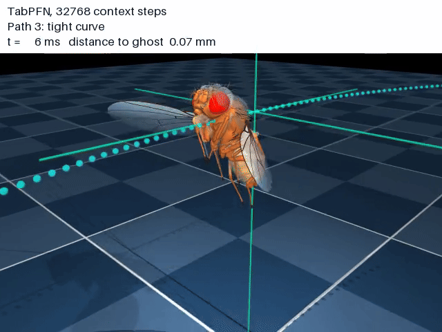
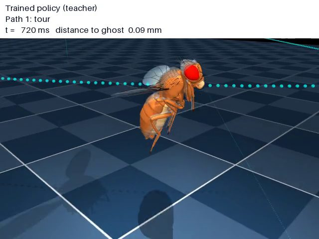
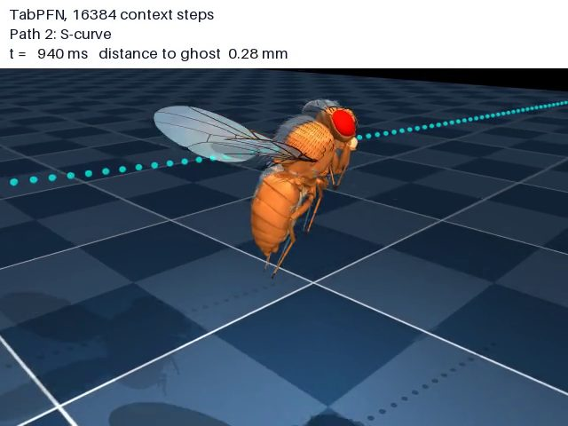
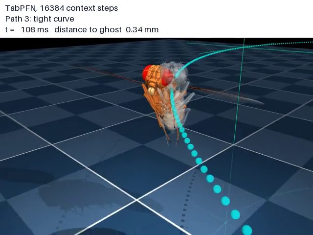
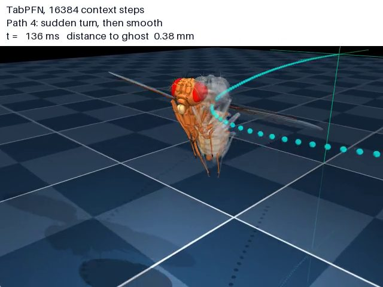
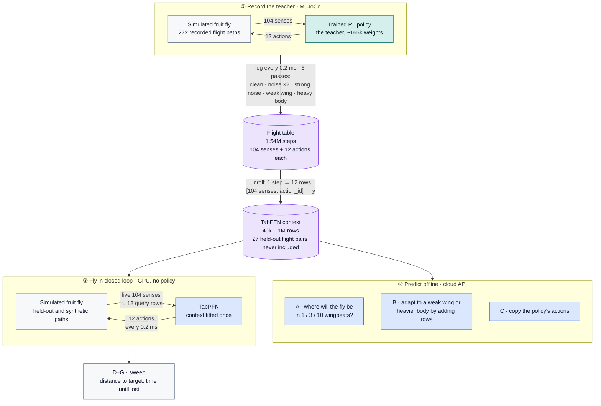
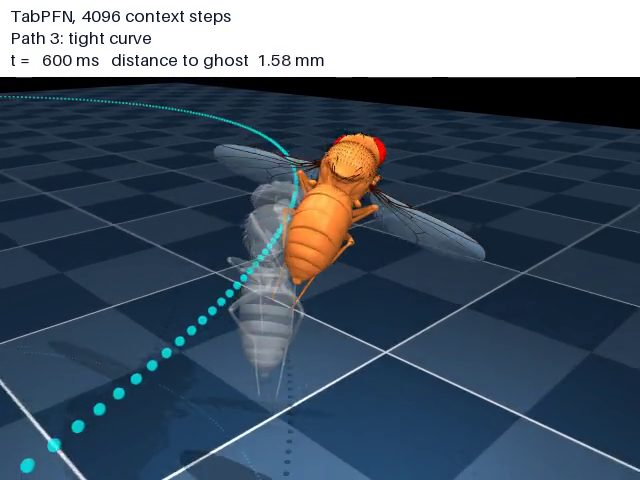
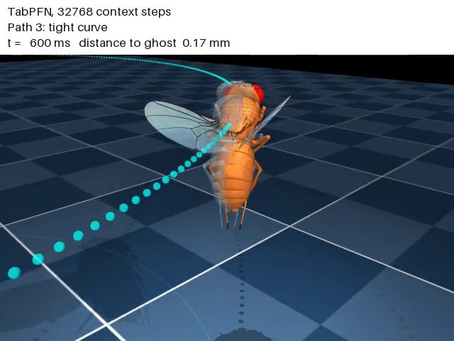
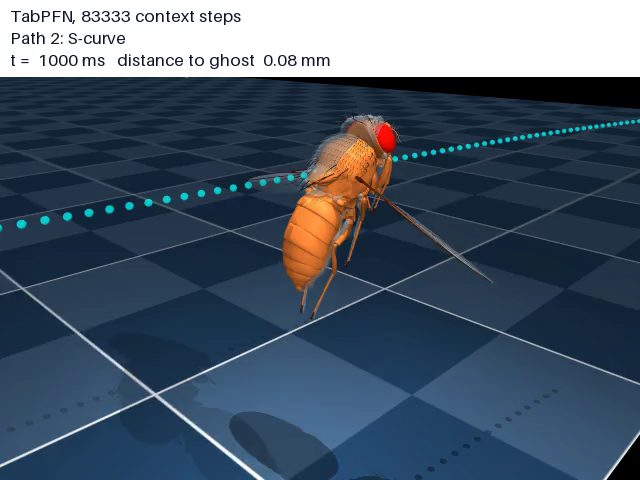

# Can a table fly a fruit fly?

**HackLab #2 Berlin · Prior Labs track "TabPFN for spatial awareness" · 21–22 Nov 2026**

We recorded a trained AI flying a simulated fruit fly, turned every 0.2 ms of flight into a row of a table, and asked **TabPFN**, a model that learns from the examples it is shown instead of from training, to predict where the fly goes and to fly it.



*TabPFN flies all 12 controls of the fly through a 360°/s tight curve for the full 1 s, 0.16 mm from the target on average, with no training: it reads 393k example rows from the trained policy's flights. Playback is 6.7× slow motion.*

| Predicting position | Adapting to a new body | Flying, big context | Still fails |
|---|---|---|---|
| **2.2×** lower error than gradient-boosted trees, one wingbeat ahead | **−44%** error on a 20% heavier fly after adding 16 example flights | **0.10 mm** off the path on an S-curve with 393k–1M rows, as precise as the trained policy | sudden **80° turns**: the path is lost within 30–80 ms |

| The teacher | TabPFN, S-curve | TabPFN, tight curve | Where it breaks |
|---|---|---|---|
|  |  |  |  |
| Trained RL policy on the 4 s tour, 0.09 mm off | All 12 actions from a table; full 2 s | 360°/s turn for the full 1 s | A sudden 80° turn; 40 ms later it is 5 mm off |

## Documentation

| Page | What it covers | Live | Source |
|---|---|---|---|
| **TabPFN Fruit Fly**: full project report | Prior Labs and TabPFN, the fruit fly, our implementation, all results with charts and video frames, the context-size sweep, limitations, improvements, glossary | [open](https://claude.ai/artifact/FN7XkVNaXNCco5KHm7vcYF) | [`docs/report.html`](docs/report.html) |

Also: data plan and column layout [`docs/data/collection-plan.md`](docs/data/collection-plan.md)

---

## The idea in four sentences

An expert pilot (a neural network trained by reinforcement learning) flies a virtual fruit fly, and we write down everything it senses and does. We give a sample of those notes to TabPFN as examples. TabPFN then reads the fly's live senses and, by analogy with the examples, says what to do next, 5,000 times per simulated second. It predicts the fly's future position better than trained models, and with enough examples it flies smooth curves on its own, but sudden sharp turns still beat it.

## Background

### Prior Labs and TabPFN

TabPFN (Tabular Prior-data Fitted Network) is a transformer pre-trained once on millions of synthetic tables. Given a table of example rows (the **context**), it predicts a missing column for new rows in a single forward pass, with no training loop and with a full predictive distribution. Prior Labs builds it; their framing for this track is "robots run on tables": change the rows and you change the behaviour.

| | |
|---|---|
| Model | TabPFN 3.5 **Fast** (84M parameters), run locally; the cloud API (3.5 Plus via `tabpfn-client`) for offline experiments |
| Limits | up to 1M context rows, 20k columns |
| Output | a distribution per prediction; we use its mean (control) or quantiles (forecasting) |
| Speed trick | `fit_mode="fit_with_cache"`: the context is encoded once, each query only adds the new rows |
| Inside | cell embedding → per-column embedder → per-row aggregator → in-context transformer where query rows attend to context rows |

### The fruit fly, real and simulated

- **Real fly** (*Drosophila*): ~2.5 mm, wingbeat ~200–220 Hz, "saccades" (80° turns at up to ~3,000°/s).
- **flybody** (Vaxenburg et al., Nature 2025; Janelia + Google DeepMind): an anatomically detailed fly in the MuJoCo physics engine.
- **Trained flight policy** (the teacher): an RL network (~165k parameters) that follows 272 recorded real flights. Every 0.2 ms it reads **104 senses** and outputs **12 actions**.

| Senses (104) | | Actions (12) | |
|---|---|---|---|
| accelerometer, gyro | 6 | head | 3 |
| joint angles | 25 | wings: yaw, roll, pitch × left/right | 6 |
| joint speeds | 25 | abdomen | 2 |
| velocity, "up" direction | 6 | wingbeat frequency | 1 |
| target (ghost) offset + rotation, now and 5 steps ahead | 42 | | |

The **ghost** is a see-through copy of the fly moved along the target path on rails (no physics). The 42 ghost inputs say where to be, not what to do, so no action is ever fed in as an input. The distance between the fly and the ghost is our tracking error.

## How it works



Read it top to bottom: **①** the trained policy flies every recorded path while we log what the fly senses and what the policy does; **②** a sample of that table is TabPFN's context for offline predictions; **③** the policy is removed and TabPFN, reading the same kind of table, sets all 12 controls of the fly itself.

### Data: six passes over every recorded flight

| Pass | Change | Purpose | Steps | Distance to ghost (mean · 95% · max) |
|---|---|---|---|---|
| 1 clean | none | prediction, copying the policy | 260,001 | 0.33 · 0.79 · 7.7 mm |
| 2 noise | action noise 0.5 × the policy's spread | controller context | 259,997 | 0.34 · 0.82 · 9.1 mm |
| 3 noise | same, another seed | controller context | 262,485 | 0.34 · 0.81 · 8.8 mm |
| 6 strong noise | action noise 2.0 × | recovery examples | 237,637 | 1.13 · 4.06 · 27.9 mm |
| 4 weak wing | left wing strength × 0.7 | adaptation (B) | 259,409 | 0.55 · 1.56 · 26.2 mm |
| 5 heavy | body mass × 1.2 | adaptation (B) | 262,418 | 0.36 · 0.90 · 10.1 mm |

Column layout: [`docs/data/collection-plan.md`](docs/data/collection-plan.md). Every experiment holds out the same 27 flight pairs (~20%), so no test flight appears in any context.

### One flying decision

TabPFN predicts **one target column**, so each recorded step is unrolled into **12 rows** that share the 104 senses and differ in an `action_id` column (0–11); the target `y` is the policy's value for that action. At decision time we send 12 query rows (the live senses with `action_id` 0–11), get 12 values back, and MuJoCo applies them for the next 0.2 ms. The context (a random sample of passes 1, 2, 3 and 6) is fitted once and never changes during a flight.

```
context row:  [104 senses] [action_id] -> y          fit(X, y): X (rows, 105), y (rows,)
query rows:   [live senses] [0..11]    -> 12 actions  one call per 0.2 ms of flight
```

### Experiments

| Exp | Question | Mode |
|---|---|---|
| A | Where will the fly be in 1, 3, 10 wingbeats? | offline (API) |
| B | Adapt to a weak wing or heavier body by adding rows? | offline (API) |
| C | Copy the policy's actions, by context size | offline (API) |
| D | Fly recorded held-out flights | closed loop |
| E | Do path shapes and sudden turns matter? | closed loop |
| F | Does adding its own mistakes (DAgger) help? | closed loop |
| G | Which actions break the flight? | closed loop |
| Sweep | How much context does flying need? (49k → 1M rows) | closed loop, H100 |

## Results

### Prediction (A–C)

**A · Future position.** Error relative to "keep the same velocity" (lower is better), and how often the 80% range holds the truth (ideal 80%):

| Horizon | TabPFN error | Trees error | TabPFN 80% coverage | Trees 80% coverage |
|---|---|---|---|---|
| 1 wingbeat | **0.20** | 0.35 | **88%** | 69% |
| 3 wingbeats | **0.34** | 0.45 | **82%** | 67% |
| 10 wingbeats | **0.62** | 0.64 | **77%** | 66% |

**B · Adapting to a changed body without training.** Forward-movement error on held-out changed-fly flights:

| Context | Heavy fly: TabPFN | Heavy fly: trees (retrained) | Weak wing: TabPFN | Weak wing: trees |
|---|---|---|---|---|
| clean flights only | 0.162 mm | 0.145 mm | 0.078 mm | 0.097 mm |
| + 4 changed flights | 0.119 mm | 0.146 mm | 0.069 mm | 0.095 mm |
| + 16 changed flights | **0.091 mm** | 0.134 mm | **0.065 mm** | 0.091 mm |
| + all changed flights | 0.069 mm | 0.105 mm | 0.056 mm | 0.082 mm |

For the heavy fly, TabPFN's 80% coverage rises from 53% to 80% with 16 flights.

**C · Copying the policy offline.** Mean R² of the 12 actions on held-out flights:

| Context steps | TabPFN | Trees | MLP |
|---|---|---|---|
| 100 | 0.20 | **0.40** | 0.09 |
| 500 | **0.69** | 0.62 | 0.25 |
| 2,000 | **0.81** | 0.77 | 0.65 |
| 8,000 | **0.86** | 0.84 | 0.81 |

Good offline scores are not enough to fly: in closed loop each small error moves the fly into a slightly unfamiliar state, and errors compound over thousands of decisions.

### Flying (D–G and the sweep)

TabPFN controls all 12 actions with no help from the policy. Each cell: flew the whole path (mean distance to the ghost) or lost it (more than 5 mm off) at the time shown.

| Path | 256 steps (3k rows, laptop) | 4k (49k) | 16k (197k) | 32k (393k) | 83k (1M) | Policy |
|---|---|---|---|---|---|---|
| S-curve, 2 s | lost at ~60 ms | full · 0.14 mm | full · 0.20 mm | **full · 0.10 mm** | **full · 0.10 mm** | full · 0.09 mm |
| Tight curve 360°/s, 1 s | lost at 61 ms | lost at 624 ms | full · 0.28 mm | **full · 0.16 mm** | full · 0.18 mm | full · 0.12 mm |
| Tour (every turn type), 4 s | – | 827 ms | 829 ms | 877 ms | 873 ms | full · 0.15 mm |
| Sudden turn at 0.15 s → smooth | – | 182 ms | 178 ms | 222 ms | 228 ms | – |
| Smooth → sudden turn at 0.6 s | – | 627 ms | 627 ms | 683 ms | 677 ms | – |

| 49k rows, tight curve, 600 ms | 393k rows, same moment | 1M rows, S-curve |
|---|---|---|
|  |  |  |
| 1.58 mm off and sliding away | 0.17 mm off, on the ghost | 0.10 mm mean over 2 s |

**What the sweep says:** smooth flight is a data-quantity problem, and it is solved: from about 400k rows TabPFN flies curves as precisely as the policy. Sudden turns are not a quantity problem: 20× more rows only delays the failure by ~50 ms. The fix has to be *which* rows are shown, or a longer look ahead at the path.

**Other findings**

- **The wings are the hard part.** With a small context (256 steps), handing only the 6 wing actions to the policy lets TabPFN fly the head, abdomen and wingbeat frequency for the full second; handing over the head or beat frequency does not.
- **Feeding the previous action in makes it worse.** At 5,000 Hz the next action is almost the last one (R² 0.89), so TabPFN copies it and stops correcting.
- **DAgger** (adding its own visited states, labelled by the policy) gave no lasting gain at 512 steps.
- **A data bug, found and fixed:** flybody adds the wingbeat pattern to the wing actions *in place* inside `env.step()`, so the first collection stored policy + pattern as some wing labels. The collector now passes a copy, and all six passes were re-collected; every number above uses the corrected data.

### Decision time (H100, 12 query rows)

| Context | 49k rows | 197k rows | 393k rows | 1M rows |
|---|---|---|---|---|
| Fit (once) | 2.6 s | 9.6 s | 24.3 s | 117.5 s |
| Per decision | 30.8 ms | 41.8 ms | 55.4 ms | 113.7 ms |
| Peak GPU memory | 14 GB | 15 GB | 21 GB | 40 GB |

The fly needs a decision every 0.2 ms, so the simulator waits for TabPFN: we measure decision quality, not live control. A GTX 1050 (3 GB) fits only 256 steps at ~270 ms per decision.

## Limitations

- **Too slow for real time:** 31–114 ms per decision against a 0.2 ms control step.
- **Sudden turns:** lost within 30–80 ms of an 80° saccade, even with 1M rows.
- **Fixed, random context:** the same rows serve every moment of a flight.
- **Imitation only:** TabPFN copies the RL policy and cannot fly better than it.
- **Few runs:** one deterministic run per setting.
- **Simulation only:** perfect target path, noise-free sensors.
- **Mean only:** the controller ignores TabPFN's own uncertainty.
- **Compute:** the context that works needs a data-centre GPU.

## How it can be improved

| Idea | Fixes | Expected impact |
|---|---|---|
| Over-sample sudden-turn rows in the context | sudden turns | high |
| Retrieve the most similar recorded rows every few ms ("choose the rows you show") | fixed context, turns | high |
| Look further ahead: add the path's turn rate 5–20 ms ahead as inputs | turns | medium–high |
| Decide once per wingbeat (~4.6 ms) and hold | speed (23× fewer calls) | medium |
| Use the predicted spread: fall back or warn when uncertain | safety | medium |
| Score candidate actions by predicted drift and pick the best | turns, robustness | medium |
| DAgger with a large context | recovery | medium |
| Real robot (drone, legged robot) at 20–50 Hz | sim only | high |

---

## Run it yourself

### 1 · Setup

```sh
git clone https://github.com/Jaseelkt007/priorlab_berlin_hack.git
cd priorlab_berlin_hack
echo "TABPFN_TOKEN=<your key from platform.priorlabs.ai>" > .env   # git ignores .env (one key for the whole repo)
cd fly                  # every command below runs from fly/
```

Accept the TabPFN 3.5 licence at https://ux.priorlabs.ai/accept-license?hf_repo_id=tabpfn_3_5.

**Simulation env** (conda, Python 3.10; `third_party/` and `data/` are gitignored):

```sh
git clone https://github.com/TuragaLab/flybody.git third_party/flybody
git -C third_party/flybody checkout d015e9bfe441bd90ae431bac24c55cb74bdbce26
conda create -y -n flybody -c conda-forge python=3.10 pip
conda run -n flybody pip install -e ./third_party/flybody "tensorflow==2.8.0" "tensorflow-probability==0.16.0" "protobuf==3.20.*" imageio imageio-ffmpeg
conda run -n flybody pip install torch --index-url https://download.pytorch.org/whl/cu126 "tabpfn>=10,<11"   # closed-loop experiments
```

Download `trained-fly-policies.zip` and `datasets_flight-imitation.zip` **in a browser** from https://doi.org/10.25378/janelia.25309105 (figshare blocks command-line downloads) and unzip both into `data/`.

**Offline-experiment env** (uv, Python 3.12):

```sh
pip install uv
uv sync                 # cloud client: needs TABPFN_TOKEN in .env
uv sync --extra local   # GPU machines: adds the local tabpfn package
```

### 2 · Watch the teacher fly

```sh
MUJOCO_GL=egl conda run -n flybody python collect/preview_flight.py --traj 0 --out flight_preview.mp4
conda run -n flybody python collect/view_flight.py --flights 14 106 68        # live viewer
conda run -n flybody python collect/view_flight.py --path tour                 # 4 s synthetic tour
```

### 3 · Collect the data (CPU, ~15 min per pass on 8 cores)

```sh
for p in 1 2 3 4 5 6; do MUJOCO_GL=egl conda run -n flybody python collect/collect_flights.py --pass-id $p; done
```

### 4 · Experiments

| | Run |
|---|---|
| A | `uv run python experiments/exp_a_forward.py` (add `--dry-run` to price the API calls first) |
| B | `uv run python experiments/exp_b_adapt.py` |
| C | `uv run python experiments/exp_c_clone.py` |
| D | `MUJOCO_GL=egl conda run -n flybody python collect/closed_loop.py --context-steps 256 --flights 3 --video` |
| E | `MUJOCO_GL=egl conda run -n flybody python collect/synthetic_paths.py --controller tabpfn --context-steps 256 --paths curve` |
| F | `MUJOCO_GL=egl conda run -n flybody python collect/dagger.py --rounds 4` |
| G | add `--policy-controls wings` (or `head`, `abdomen`, `beat`) and `--diagnose` to E |
| Showreel | `MUJOCO_GL=egl python collect/showreel.py --controller tabpfn --context-steps 16384 --video-seconds 120` |
| Sweep | `showreel.py ... --once --out results/sweep` per context size, then `uv run python experiments/sweep_summary.py` |

A–C call the TabPFN API and cache results in `results/<exp>/cache` (keyed by name: delete the cache after changing data). Closed-loop runs need a CUDA GPU; a 3 GB card fits 256 context steps.

### 5 · Big contexts on a cloud GPU

We used a Nebius H100 (80 GB). One script builds `.venv-fly` with the same versions as the conda env:

```sh
# from your machine: code, data, key and weights (data/ and .env are not in git)
rsync -a --exclude data/ --exclude third_party/ --exclude .venv/ --exclude '*.mp4' ./ <host>:priorlab_berlin_hack/fly/
rsync -a ../.env <host>:priorlab_berlin_hack/
rsync -a data/flights data/policies data/flight-imitation <host>:priorlab_berlin_hack/fly/data/
rsync -a ~/.cache/tabpfn/tabpfn-v3.5-fast-*.safetensors <host>:.cache/tabpfn/
# on the GPU machine
cd priorlab_berlin_hack/fly && bash scripts/setup_gpu_box.sh
MUJOCO_GL=egl .venv-fly/bin/python collect/showreel.py --controller tabpfn --context-steps 32768 --once --out results/sweep
```

**Live demo with the brain in the cloud:** TabPFN runs on the GPU machine, the viewer on your laptop.

```sh
# GPU machine (listens on localhost only)
MUJOCO_GL=egl .venv-fly/bin/python collect/remote_brain.py serve --context-steps 16384 --port 7777
# laptop
ssh -N -L 7777:localhost:7777 <host> &
conda run -n flybody python collect/view_flight.py --controller remote --path tour
```

## Repository map

Everything in `collect/` runs in the **flybody** conda env (MuJoCo + the TF policy + local TabPFN); everything in `experiments/` runs in the light **uv** env and only reads `data/flights/`.

| Path | What |
|---|---|
| `collect/collect_flights.py` | runs the policy over all flights, writes `data/flights/pass*.npz` |
| `collect/closed_loop.py` | `TabPFNController` (context building, 12-row queries) and experiment D |
| `collect/synthetic_paths.py` | synthetic paths, experiment E and the split test (G) |
| `collect/dagger.py` | experiment F |
| `collect/showreel.py` | labelled multi-path videos and the context-size sweep |
| `collect/view_flight.py` | live MuJoCo viewer (policy, TabPFN or remote TabPFN) |
| `collect/remote_brain.py` | TabPFN decision server for a remote GPU |
| `experiments/` | offline experiments A–C, sweep summary, plots (run in the **uv** env) |
| `results/` | JSON results and drift logs; [`results/README.md`](results/README.md) says which runs used the corrected data (videos are local only) |
| `scripts/setup_gpu_box.sh` | one-step GPU machine setup |
| `docs/` | the project report (`report.html`), its images, the data plan |
| [`../DEBT.md`](../DEBT.md) | every quick fix taken during the hackathon and its real fix (shared by the whole team) |

## Credits

flybody and the trained flight policy: TuragaLab, Janelia and Google DeepMind (Vaxenburg et al., Nature 2025). TabPFN: Prior Labs (model weights under their non-commercial licence). Inspired by DuckPFN. Built at HackLab #2 Berlin with BRISA.
