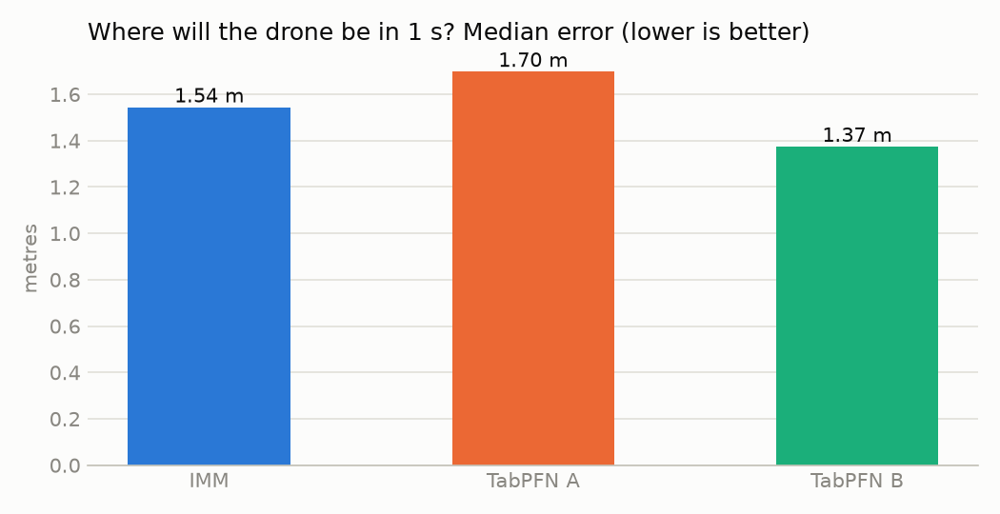
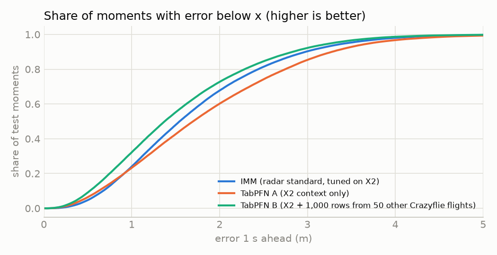
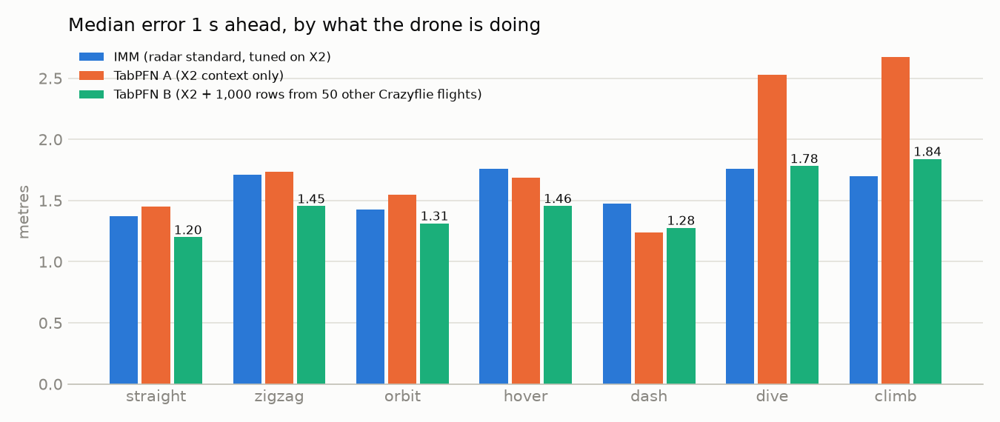

# Results: IMM vs TabPFN, where will the drone be in 1 second?

Generated by `python drone/report.py`. Every number below is in the CSV files next to this page.

## Setup in one paragraph

A radar at the protected zone sees an intruder drone 10 times a second (noise 0.3 m + 1% of range, about 11% of
readings missing). At every reading each model predicts **where the drone will be 1 s later (x, y, z)**, with a 90%
range, and **whether it enters the zone within 2 s** (the alarm). Test set: **250
Crazyflie flights, 112,501 moments** (every radar reading whose future is known), all models on exactly the
same moments. The IMM was tuned on X2 (big drone) flights. TabPFN gets no training: version A sees 4,000 X2 rows as
context; version B also sees 1,000 rows from 50 other Crazyflie flights (never tested on).

## Headline

| Model | Median error | 90% of errors below | Range holds the truth (target 90%) | Alarm AUC | Breaches caught (1 false alarm per 20) | Warning before breach (median) |
|---|---|---|---|---|---|---|
| IMM (radar standard, tuned on X2) | **1.54 m** | 2.98 m | 89% (width 3.6 m) | 0.991 | 99% | 3.9 s |
| TabPFN A (X2 context only) | **1.70 m** | 3.28 m | 93% (width 4.7 m) | 0.989 | 95% | 4.5 s |
| TabPFN B (X2 + 1,000 rows from 50 other Crazyflie flights) | **1.37 m** | 2.83 m | 93% (width 3.7 m) | 0.993 | 98% | 4.4 s |

- **TabPFN B is 11% more accurate than the IMM** (1.37 vs
  1.54 m) and closer than the IMM at **62% of all moments**.
- **TabPFN A (never saw a Crazyflie) is +10%** against the IMM: X2 examples (10 m/s) do not
  transfer fully to a 3 m/s drone. A few examples of the new drone in the context are enough to close that gap.
- **The alarm is close to solved by every model** (AUC near 1): 2 s ahead, a 3 m/s drone cannot surprise much.

## By manoeuvre

TabPFN B is better than the IMM on: straight, zigzag, orbit, hover, dash;
worse on: dive, climb.

| manoeuvre | rows | IMM | TabPFN A | TabPFN B |
|---|---|---|---|---|
| straight | 36571 | 1.37 | 1.45 | 1.20 |
| zigzag | 25181 | 1.71 | 1.74 | 1.45 |
| orbit | 16160 | 1.43 | 1.55 | 1.31 |
| hover | 6941 | 1.76 | 1.69 | 1.46 |
| dash | 8369 | 1.48 | 1.24 | 1.28 |
| dive | 9919 | 1.76 | 2.53 | 1.78 |
| climb | 9360 | 1.70 | 2.68 | 1.84 |

## By distance from the zone

The radar is noisier far away (1% of range), so everything gets harder with distance.

| distance_to_zone_centre | rows | IMM | TabPFN A | TabPFN B |
|---|---|---|---|---|
| 0-15 m | 5458 | 1.49 | 1.64 | 1.33 |
| 15-25 m | 16788 | 1.44 | 1.53 | 1.30 |
| 25-35 m | 26295 | 1.49 | 1.67 | 1.37 |
| 35-45 m | 27285 | 1.55 | 1.71 | 1.38 |
| 45-70 m | 36675 | 1.64 | 1.79 | 1.42 |

## When the drone changes what it is doing

| moment | rows | IMM | TabPFN A | TabPFN B |
|---|---|---|---|---|
| manoeuvre keeps going | 89245 | 1.56 | 1.72 | 1.39 |
| manoeuvre changes within 1 s | 23256 | 1.49 | 1.61 | 1.31 |

## Caveats (read before quoting the numbers)

- **Simulation only:** one simulator, one scripted intruder pilot; the test flights use the same pilot as the context
  (different drone, different random flights).
- **TabPFN B saw Crazyflie data, the IMM did not:** the IMM's 5 settings were tuned on X2 flights only. A fully fair
  check re-tunes the IMM on the same 50 Crazyflie flights (planned).
- **Context:** 4,000 random X2 rows out of ~400,000; larger or similarity-picked contexts are untested.
- **The IMM is told the true radar noise level;** TabPFN is not.

## Videos

In `videos/` (not in git, too large): `demo_radar_54.mp4` (camera on the building), `demo_chase_54.mp4` (behind the
drone, close-up inset), and `imm_vs_tabpfn_54.mp4` if present (both predictions on the same flight).
