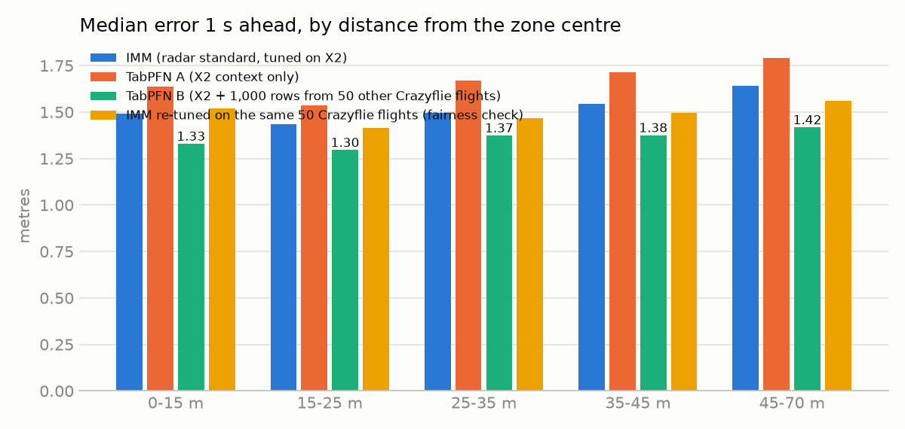

# Results: IMM vs TabPFN, where will the drone be in 1 second?

Generated by `python drone/report.py`. Every number below is in the CSV files next to this page.

## Setup in one paragraph

A radar at the protected zone sees an intruder drone 10 times a second (noise 0.3 m + 1% of range, about 11% of
readings missing). At every reading each model predicts **where the drone will be 1 s later (x, y, z)**, with a 90%
range, and **whether it enters the zone within 2 s** (the alarm). Test set: **250
Crazyflie flights, 112,501 moments** (every radar reading whose future is known), all models on exactly the
same moments. The IMM was tuned on X2 (big drone) flights. TabPFN gets no training: version A sees 4,000 X2 rows as
context; version B also sees 1,000 rows from 50 other Crazyflie flights (never tested on).

## Headline

| Model | Median error | 90% of errors below | Range holds the truth (target 90%) | Alarm AUC | Breaches caught (1 false alarm per 20) | Warning before breach (median) |
|---|---|---|---|---|---|---|
| IMM (radar standard, tuned on X2) | **1.54 m** | 2.98 m | 89% (width 3.6 m) | 0.991 | 99% | 3.9 s |
| TabPFN A (X2 context only) | **1.70 m** | 3.28 m | 93% (width 4.7 m) | 0.989 | 95% | 4.5 s |
| TabPFN B (X2 + 1,000 rows from 50 other Crazyflie flights) | **1.37 m** | 2.83 m | 93% (width 3.7 m) | 0.993 | 98% | 4.4 s |
| IMM re-tuned on the same 50 Crazyflie flights (fairness check) | **1.50 m** | 3.04 m | 82% (width 2.8 m) | 0.987 | 98% | 3.5 s |

- **TabPFN B is 11% more accurate than the IMM** (1.37 vs
  1.54 m) and closer than the IMM at **62% of all moments**.
- **Fair comparison:** with the IMM re-tuned on the same 50 Crazyflie flights (1.50 m), TabPFN B is still **8% better**. See the fairness check below.
- **TabPFN A (never saw a Crazyflie) is +10%** against the IMM: X2 examples (10 m/s) do not
  transfer fully to a 3 m/s drone. A few examples of the new drone in the context are enough to close that gap.
- **The alarm is close to solved by every model** (AUC near 1): 2 s ahead, a 3 m/s drone cannot surprise much.

## By manoeuvre

TabPFN B is better than the IMM on: straight, zigzag, orbit, hover, dash;
worse on: dive, climb.

| manoeuvre | rows | IMM | TabPFN A | TabPFN B | IMM re-tuned |
|---|---|---|---|---|---|
| straight | 36571 | 1.37 | 1.45 | 1.20 | 1.29 |
| zigzag | 25181 | 1.71 | 1.74 | 1.45 | 1.69 |
| orbit | 16160 | 1.43 | 1.55 | 1.31 | 1.38 |
| hover | 6941 | 1.76 | 1.69 | 1.46 | 1.75 |
| dash | 8369 | 1.48 | 1.24 | 1.28 | 1.43 |
| dive | 9919 | 1.76 | 2.53 | 1.78 | 1.79 |
| climb | 9360 | 1.70 | 2.68 | 1.84 | 1.70 |

## By distance from the zone

The radar is noisier far away (1% of range), so everything gets harder with distance.

| distance_to_zone_centre | rows | IMM | TabPFN A | TabPFN B | IMM re-tuned |
|---|---|---|---|---|---|
| 0-15 m | 5458 | 1.49 | 1.64 | 1.33 | 1.52 |
| 15-25 m | 16788 | 1.44 | 1.53 | 1.30 | 1.42 |
| 25-35 m | 26295 | 1.49 | 1.67 | 1.37 | 1.47 |
| 35-45 m | 27285 | 1.55 | 1.71 | 1.38 | 1.50 |
| 45-70 m | 36675 | 1.64 | 1.79 | 1.42 | 1.56 |

## When the drone changes what it is doing

| moment | rows | IMM | TabPFN A | TabPFN B | IMM re-tuned |
|---|---|---|---|---|---|
| manoeuvre keeps going | 89245 | 1.56 | 1.72 | 1.39 | 1.52 |
| manoeuvre changes within 1 s | 23256 | 1.49 | 1.61 | 1.31 | 1.44 |

## Fairness check: the IMM gets the same Crazyflie data

TabPFN B saw 1,000 rows from Crazyflie flights 0-49. To be fair, the IMM's 5 settings were tuned again on the same 50 flights (`python drone/imm.py --tune --drone cf2`): `{'q_cv': 0.3, 'q_ca': 0.0001, 'q_ct': 0.001, 'q_turn': 0.0001, 'p_stay': 0.9997}`.

| | Median error 1 s ahead |
|---|---|
| IMM tuned on X2 | 1.54 m |
| IMM re-tuned on Crazyflie flights 0-49 | 1.50 m |
| TabPFN B | 1.37 m |

TabPFN B is still **8% better** with the same data.

## A pilot no model has seen

Every flight so far (examples and tests) was flown by the same scripted pilot, so TabPFN could have learned that pilot's habits. Here 250 new Crazyflie flights are flown by **pilot b**: another manoeuvre mix, switching about twice as often, sharper zigzags, bigger height changes (`python drone/intruder.py --drone cf2 --pilot b`). Nothing was re-tuned: TabPFN keeps its pilot-a examples, the IMM its settings. 116,914 moments, 1875 breach rows.

| Model | Error on pilot b | Same model on pilot a | Breaches caught |
|---|---|---|---|
| IMM (radar standard, tuned on X2) | **1.80 m** | 1.54 m | 100% |
| TabPFN A (X2 context only) | **2.25 m** | 1.70 m | 85% |
| TabPFN B (X2 + 1,000 rows from 50 other Crazyflie flights) | **1.67 m** | 1.37 m | 96% |
| IMM re-tuned on the same 50 Crazyflie flights (fairness check) | **1.82 m** | 1.50 m | 97% |

TabPFN B is still **8% better** than the best IMM on a pilot it never saw. TabPFN B's 90% range holds the truth 90% of the time on pilot b.

## How many examples of the new drone does TabPFN need?

Same test moments for every point (every 5th reading, 22,501 moments). TabPFN beats both IMMs from **250 Crazyflie rows** (about 25 s of radar on the new drone).

| crazyflie_rows_in_context | test_rows | TabPFN B | IMM | IMM re-tuned |
|---|---|---|---|---|
| 0 | 22501 | 1.70 | 1.54 | 1.50 |
| 100 | 22501 | 1.56 | 1.54 | 1.50 |
| 250 | 22501 | 1.45 | 1.54 | 1.50 |
| 500 | 22501 | 1.40 | 1.54 | 1.50 |
| 1000 | 22501 | 1.37 | 1.54 | 1.50 |
| 2000 | 22501 | 1.37 | 1.54 | 1.50 |

## Caveats (read before quoting the numbers)

- **Simulation only:** one simulator, scripted intruder pilots (see "A pilot no model has seen" for a second pilot).
- **Context:** 4,000 random X2 rows out of ~400,000; larger or similarity-picked contexts are untested.
- **The IMM is told the true radar noise level;** TabPFN is not.

## Videos

In `videos/` (not in git, too large): `scene_54.mp4` (the world: building, intruder, defender),
`imm_vs_tabpfn_chase_54.mp4` (behind the drone, both predictions, close-up inset) and `imm_vs_tabpfn_54.mp4` (the same
from the radar on the roof).
